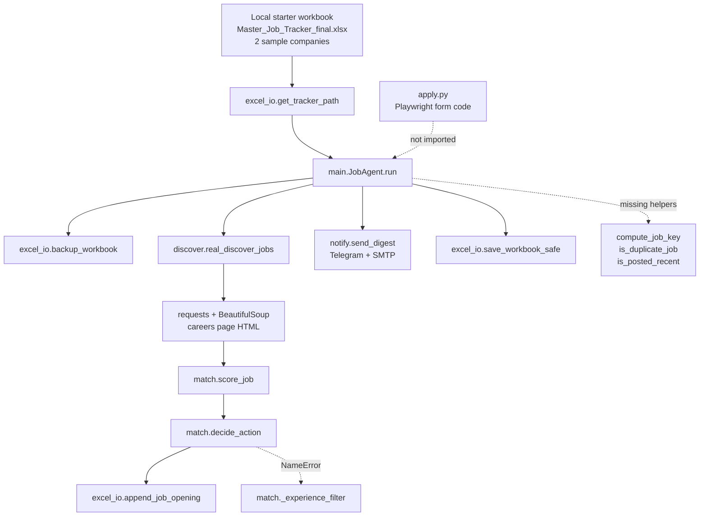

# Current project audit

Audit date: **2026-11-06**  
Task: **A-000 (read-only inventory)**  
Scope: source code, configuration, scripts, directories, workbooks, environment, and prior planning claims.  
No files outside `project-planning/` were modified. No network calls were made. No workbook was written.

**Post-A-002 update:** Git was initialized and the skeleton directories plus blank example YAML templates were created after this audit. **Post-A-003 update:** five root `__pycache__` `.pyc` files were archived and the move was logged. The audit findings below remain the A-000 baseline. See `PROJECT_STATUS.md` for current state.

## 1. Executive summary

The repository is a **pre-alpha prototype**. There is no working end-to-end discovery, filtering, ranking, deduplication, queue, or tracking pipeline. The visible modules contain useful prototypes and some correct Excel helpers, but the main path fails before it can produce a job:

- `main.py` calls three discovery helpers that do not exist.
- `match.decide_action()` raises `NameError` on an undefined name.
- Skill scoring is based on configuration lists, not the job text.
- The live path writes fake `.png` proof files and marks companies as applied.
- The resolver chooses the local 2-row starter workbook before the 693-row parent workbook.
- The Global Product Targets mapping reads the wrong columns and ignores hyperlink targets.
- There is no Git repository, no test suite, no SQLite database, no package layout, no dashboard, and no logging implementation.

The authoritative workbook is **not confirmed**. The parent workbook is the only 693-company workbook present, but the owner must confirm it with **H-01** before any import.

## 2. Current architecture (as implemented)



There is no SQLite layer, no normalizer, no validator, no classifier, no 3-layer dedupe, no quota selector, no daily queue, and no dashboard. Excel is the only state store.

## 3. Inventory summary

### 3.1 Files present

| Area | Count | Notes |
|---|---:|---|
| Python modules | 9 | `main`, `discover`, `match`, `excel_io`, `apply`, `notify`, `create_tracker`, `add_companies`, `clear_tracker` |
| YAML/config files | 4 | `config.yaml`, `profile.yaml`, `answers.yaml`, `.env.example` |
| Documentation | 3 | `README.md`, `require.md`, `shareable-project-report/` (3 files) |
| Launchers | 2 | `run_job_agent.bat`, `run_job_agent.sh` |
| Workbook | 1 local | 5-sheet starter, 2 sample companies |
| Resume | 1 PDF | Exists; contents deliberately not read; filename withheld |
| Cache files | 5 | `__pycache__/*.pyc` |
| Runtime directories | 3 | `browser_profile/`, `logs/`, `proofs/` - all empty |
| Planning | new | `project-planning/` |

### 3.2 Missing structure

Absent: `.git/`, `job_agent/`, `tests/`, `config/`, `data/`, `docs/`, `archive/`, `backups/`, SQLite files, `.env`, test files, notebooks.

### 3.3 Workbook inventory

| Workbook | Sheets | Companies | Tiers | Careers URLs | Openings URLs | Global targets | Application Tracker rows | Recruiter Contacts rows |
|---|---:|---:|---|---:|---:|---:|---:|---:|
| Local starter | 5 | 2 | 1 Tier 1, 1 Tier 2 | 2 | 2 | 0 | 0 | 0 |
| Parent workbook | 19 | 693 | 215 / 160 / 71 / 247 | 526 | 545 | 50 | 5 | 694 |

Additional facts:

- Local starter `Companies`: 2 rows, both `Open`; `Job Openings` empty; `Daily Run Log` has 3 dry-run rows; `Application Tracker` empty; `Global Product Targets` empty.
- Parent workbook: 19 sheets, 69-column `Companies`, 0 duplicate Master IDs, 0 blank Master IDs, all 693 statuses are `Not Started`.
- Parent workbook: 526 valid `Official Careers Page` URLs, 545 valid `Current Openings URL` cells, 545 companies with at least one valid URL, 440 unique URL hosts.
- Parent workbook: known ATS URL cells are **6** (Keka 4, Zoho 2) across **3 distinct hostnames** and **2 providers**. The prior claim of "only 4 recognizable ATS hosts" is not accurate as stated.
- Parent workbook: `Global Product Targets` has 15 columns; 50 data rows; 50 hyperlinks in `LinkedIn People Search`; 50 hyperlinks in `Careers Page`; only 23 rows have `Matched Master ID (Companies)`.
- Parent workbook: `Application Tracker` has 5 populated rows and **1 cell containing `example.com`** (count only; not treated as real data).
- Parent workbook: **no `Job Openings` sheet and no `Daily Run Log` sheet**.
- No `backups/` directory and no backup workbook were found. The historical backup claim is contradicted by the current filesystem.

## 4. Implemented, broken, and missing

### 4.1 Implemented prototypes

- Excel load/save helpers, sheet creation, row appends, daily log append, backup helper.
- HTML careers-page fetch and heuristic link extraction.
- Basic role, experience, education, location, and tier scoring heuristics.
- Telegram/email message senders.
- CLI argument skeleton and lock-file helper.
- Launcher scripts.

### 4.2 Broken or unsafe

- Discovery helper calls do not exist.
- Decision logic raises `NameError`.
- Skill scoring ignores job text.
- Live mode can set `dry_run` false.
- Simulated apply path writes fake proof files and updates application state.
- Telegram/email sends are attempted on every run, including dry-run, and are not config-gated.
- Backup retention permanently deletes old backups.
- Local starter workbook is preferred over the parent master.
- Global Product Targets mapping is wrong and ignores hyperlinks.
- Relative URLs are discarded.
- `apply.py` contains Playwright form-filling code and is not imported, but it is a latent risk if wired in.
- `.gitignore` does not cover profile, answers, the actual resume, or workbooks.

### 4.3 Missing

- Authoritative workbook configuration and read-only import.
- ATS resolution and adapters.
- Normalizer, validator, experience classifier, work-mode classifier, country eligibility.
- Word-boundary skill extraction.
- Gated scorer with stored breakdown.
- Three-layer dedupe and applied-history checks.
- Quota selector and daily queue.
- SQLite database, migrations, repository layer.
- Local dashboard.
- Tests, fixtures, CI, lint, typecheck.
- Logging with redaction.
- Git repository and PII-safe ignore rules.
- Scheduling without interactive prompts.

## 5. Issues by priority

### P0 - safety, data-loss, or correctness blockers

1. **Live mode is reachable.** `main.py:286-293` sets `dry_run = not args.live`; `--live` can disable dry-run if config says `dry_run: false`. This violates the absolute restriction.
2. **Fake application path is reachable in live mode.** `main.py:192` calls `self.apply_job`; `main.py:264-274` writes the literal text `proof` into a `.png` file and returns success. `main.py:197-212` marks the company applied and writes an application-tracker entry with a fake proof path.
3. **Missing discovery helpers.** `main.py:126-130` calls `discover.compute_job_key`, `discover.is_duplicate_job`, and `discover.is_posted_recent`. None exist in `discover.py`; each discovered candidate raises `AttributeError`.
4. **Decision logic crashes.** `match.py:279` calls `match._experience_filter`; `match` is not defined inside `match.py` and `_experience_filter` does not exist. Reproduced: `NameError: name 'match' is not defined`.
5. **Wrong tracker is preferred.** `excel_io.py:47-53` checks `.` before `..`; from the repository root it returns the local 2-row starter, not the 693-row parent workbook. It also contains a hard-coded fallback path.
6. **Global Product Targets mapping is wrong.** `main.py:100-108` reads columns 1, 2, 4, 3, 3. The workbook headers require `N` (14) for Matched Master ID, `H` (8) for Careers Page, and `J` (10) for Status. The code also ignores `cell.hyperlink.target`, so visible labels such as "Open Careers Page" are used as URLs.
7. **Permanent deletion is implemented.** `excel_io.py:56-70` deletes old backups with `unlink()`. `clear_tracker.py:7` deletes all data rows. `add_companies.py:19` and `create_tracker.py:69` overwrite the local workbook.
8. **No Git and incomplete ignores.** There is no `.git/`. `.gitignore` covers `.env`, logs, caches, proofs, backups, and `resume_*.pdf`, but not `profile.yaml`, `answers.yaml`, `*.xlsx`, `*.sqlite*`, `data/`, or the actual resume filename. Secrets/PII would be trackable.
9. **Outbound contact attempts.** `main.py:230` and `main.py:255` call `notify`; `notify.py:13-26` posts to Telegram; `notify.py:29-52` sends SMTP. These run even in dry-run and ignore the `notifications` config.

### P1 - required for a trustworthy pipeline

1. **Skill scoring ignores the job.** `match.py:115-162` iterates `must_have`/`nice_to_have` from config and never reads `title`/`desc`. A non-software `Accountant` job scored **90** with the current config (prior exact value 85 not reproduced; the behavior is confirmed).
2. **Role matching uses substrings and defaults to accept.** `match.py:63-78` uses `kw in combined`, so word-boundary errors are likely; the function returns `True` when no keyword matches.
3. **Relative URLs are dropped.** `discover.py:137-145` resolves root-relative links against `https://example.com` and then discards them. A root-relative link returned 0 jobs; an absolute link returned 1.
4. **No rate limiting, Retry-After, caching, or circuit breaker.** `discover.py:66-94` retries with a fixed sleep, does not honor `Retry-After`, has no per-host limit, and returns empty on failure.
5. **Robots handling is permissive on error.** `discover.py:44-60` returns `True` when robots.txt cannot be fetched.
6. **No ATS adapters.** Discovery is a static HTML link heuristic; no Greenhouse, Lever, Ashby, SmartRecruiters, Workable, JSON-LD, sitemap, or RSS adapter exists.
7. **No normalization, validation, 3-layer dedupe, or quota.** `main.py` does a simple key/URL check and appends everything else.
8. **CLI flags are parsed but ignored.** `main.py:280-283` defines `--discover-only`, `--report`, and `--dry-run`, but only `--live` affects flow.
9. **Dependency/runtime mismatch.** Installed Python is **3.15.0**. `requirements.txt` pins older versions (`openpyxl 3.1.2`, `PyYAML 6.0.1`, `requests 2.31.0`, `playwright 1.40.0`, `lxml 4.9.3`, `Pillow 10.1.0`). Missing: `playwright`, `Pillow`, `schedule`, `python-dateutil`, `rich`, `pytest`.
10. **Notifications are not config-gated or escaped.** `notify.py` reads env directly and interpolates job text into HTML.

### P2 - quality, performance, maintainability

1. `main.py:57-72` uses a bare `except` in lock handling; stale-lock behavior is unclear.
2. `main.py:200` can raise `ValueError` near month end when adding 7 days with `replace(day=...)`.
3. `excel_io.py:103-105` adds validation to 10,000 rows per new sheet; this is slow and unnecessary.
4. `excel_io.py:121-134` does not detect Excel `~$` lock files; it retries and copies.
5. `excel_io.py:184-187` and `excel_io.py:209` use hard-coded column indexes (10 and 16) instead of headers.
6. `excel_io.py:256-273` scans 200 rows ahead for the next tracker row and does not extend formulas.
7. `pending_updates.json` is referenced in `main.py:20` but never implemented.
8. `run_job_agent.bat` contains `pause`; it is not scheduler-safe. `run_job_agent.sh` does not activate a virtualenv or log.
9. `README.md` claims ATS feeds, safe auto-apply, discovery-only/report modes, and crash-safe pending updates that are not implemented.
10. `require.md` is a historical audit with claims that no longer match the filesystem (backups, resume availability).

### P3 - polish and documentation

1. `shareable-project-report/` contains useful analysis but repeats the outdated backup and "4 ATS" claims; it needs reconciliation.
2. `__pycache__/` is present in the working tree.
3. No `docs/` directory, schema document, or architecture decision records.
4. No config examples for `preferences.yaml`, `profile.example.yaml`, or `answers.example.yaml`.
5. No `.gitattributes`, editor configuration, or line-ending policy.
6. Emoji/HTML in notification strings is not redaction-friendly.
7. The local starter workbook and the parent master share the same filename, which is a persistent confusion risk.

## 6. Claim-by-claim verification

| # | Prior claim | Status | Evidence |
|---:|---|---|---|
| 1 | Excel I/O (`excel_io.py`) works | PARTIAL | `get_tracker_path` and workbook load work; write/backup paths were inspected but not executed; no tests |
| 2 | Notifications (`notify.py`) work | UNVERIFIED | Source exists; no env, no network, no tests; delivery not proven |
| 3 | `main.py` calls missing discovery helpers | VERIFIED | `main.py:126-130`; `hasattr` returned False for all three |
| 4 | `match.decide_action()` raises `NameError` | VERIFIED | Reproduced `NameError: name 'match' is not defined` at `match.py:279` |
| 5 | `_score_skills()` scores config lists, not job text | VERIFIED | `match.py:115-194`; identical scores with unrelated title/description |
| 6 | A non-software job scored 85 | PARTIAL | Behavior verified; current config produced **90** for an `Accountant` job, not 85 |
| 7 | `main.apply_job()` is a simulator writing fake `.png` text and marking applied | VERIFIED | `main.py:264-274`, `main.py:197-212` |
| 8 | `apply.py` is never imported and never submits | VERIFIED | Import graph: `apply <- []`; no `import apply`; `fill_and_submit` returns `False` before submit |
| 9 | Tracker resolution prefers local 2-row starter over parent master | VERIFIED | `excel_io.py:47-53`; from repo root returned local starter |
| 10 | Tracker resolution has a hard-coded fallback path | VERIFIED | `excel_io.py:49`; fallback path does not exist on disk |
| 11 | Global Product Targets uses columns 1/3/4 instead of 14/8/10 and ignores hyperlinks | VERIFIED | `main.py:100-108`; workbook headers: N=14, H=8, J=10; 50 H hyperlinks exist |
| 12 | `discover.py` drops relative URLs | VERIFIED | `discover.py:137-145`; root-relative link returned 0, absolute returned 1 |
| 13 | `.gitignore` does not cover profile/answers/resume/workbook | VERIFIED | `.gitignore:1-17`; actual resume filename does not match `resume_*.pdf` |
| 14 | No tests | VERIFIED | No `tests/` and no `test_*.py`/`*_test.py` |
| 15 | No Git repository | VERIFIED | `git rev-parse` returned "not a git repository" |
| 16 | `logs/` is empty | VERIFIED | 0 entries |
| 17 | Backups contain 2 placeholder `example.com` jobs | CONTRADICTED | No `backups/` directory and no backup workbook found; master `Application Tracker` has 1 `example.com` cell, local workbook has 0 |
| 18 | Master workbook has 19 sheets | VERIFIED | 19 sheet names returned |
| 19 | Master workbook has 693 companies | VERIFIED | 693 non-empty Master IDs |
| 20 | Tiers are 215/160/71/247 | VERIFIED | Tier 1 215, Tier 2 160, Tier 3 71, Tier 4 247 |
| 21 | 526 careers URLs | VERIFIED | 526 valid `Official Careers Page` URLs |
| 22 | Only 4 recognizable ATS hosts | CONTRADICTED | 6 known ATS URL cells: Keka 4, Zoho 2; 3 distinct hostnames, 2 providers |
| 23 | 50 global targets | VERIFIED | 50 data rows, 50 careers hyperlinks, 23 matched Master IDs |
| 24 | 694 recruiter contact data rows | VERIFIED | `Recruiter Contacts` max row 695 including header |
| 25 | Local starter has 2 sample company rows, both `Open` | VERIFIED | 2 rows, status counts `Open: 2` |
| 26 | Local starter has 3 dry-run log rows | VERIFIED | 3 rows, all mode `dry`, notes `Dry-run: True` |
| 27 | Local starter `Job Openings` is empty | VERIFIED | Header only, 0 key rows |
| 28 | Resume files are both missing | CONTRADICTED | One PDF exists; contents not read; filename withheld |
| 29 | No `.env` | VERIFIED | `Test-Path .env` returned False |
| 30 | No SQLite, package, tests, config, data, archive directories | VERIFIED | All path checks returned False |

## 7. Import graph

```text
main.py    -> discover, excel_io, match, notify
apply.py   -> notify
notify.py  -> (no local imports)
discover.py-> (no local imports)
match.py   -> (no local imports)
excel_io.py-> (no local imports)
add_companies.py, clear_tracker.py, create_tracker.py -> (no local imports)

Reverse dependencies:
notify     <- main.py, apply.py
apply      <- none
excel_io   <- main.py
discover   <- main.py
match      <- main.py
main       <- none
```

`notify.py` is therefore reachable from both `main.py` and `apply.py`. `apply.py` is unreachable today, but it is a latent risk because it contains Playwright form-filling code.

## 8. Environment

| Item | Observed |
|---|---|
| Python | 3.15.0 |
| pip | 26.3 |
| Installed | `beautifulsoup4 4.15.0`, `certifi`, `charset-normalizer`, `et_xmlfile`, `idna`, `lxml 6.1.3`, `openpyxl 3.1.5`, `pip`, `pypdf 6.21.4`, `python-dotenv 1.2.4`, `PyYAML 6.0.3`, `requests 2.34.2`, `soupsieve`, `typing_extensions`, `urllib3` |
| Missing | `playwright`, `Pillow`, `schedule`, `python-dateutil`, `rich`, `pytest` |
| Virtualenv | None present |
| Git | Not a repository |
| Excel lock | No `~$` file found; no `job_agent.lock`; no `pending_updates.json` |
| Network | No network calls made during A-000 |

## 9. UNVERIFIED items

- Whether the parent workbook is the owner's intended authoritative master (H-01).
- Whether the 693 company records and 1,071 URL cells are correct or current.
- Whether the historical backups referenced in `require.md` and `shareable-project-report/` ever existed, and whether they were deleted.
- Whether the single `example.com` cell in the master `Application Tracker` is an intentional placeholder.
- Whether the local starter workbook was changed manually from the `Closed` values written by `add_companies.py` to the current `Open` values.
- Telegram and SMTP delivery, because no credentials are configured and no network was used.
- Live ATS/careers-page behavior, because no live spike was approved.
- Whether `excel_io` preserves all formulas, validations, conditional formats, and hyperlinks on write. `require.md` claims 7,980 hyperlinks and 1,511 formulas were preserved in a prior round-trip; this audit did not repeat that write test.
- Resume readability, page count, and content (privacy).
- `profile.yaml` and `answers.yaml` contents (deliberately not read).
- Whether the 545 openings URLs resolve or are still live.

## 10. Verification evidence (representative)

```text
MISSING_DISCOVERY_HELPERS {'compute_job_key': False, 'is_duplicate_job': False, 'is_posted_recent': False}
NON_SOFTWARE_SCORE 90
DECIDE_ACTION_EXCEPTION NameError name 'match' is not defined
SKILL_SCORE_TEXT_INDEPENDENT True
TRACKER_PATH Master_Job_Tracker_final.xlsx
HARDCODED_FALLBACK_EXISTS False
RELATIVE_LINKS_KEPT 0
ABSOLUTE_LINKS_KEPT 1

LOCAL_STARTER: sheets 5; companies 2; tiers {Tier 1: 1, Tier 2: 1}; status {Open: 2};
  Job Openings key rows 0; Daily Run Log data rows 3; Application Tracker rows 0; Global targets 0
PARENT_MASTER: sheets 19; companies 693; tiers {Tier 1: 215, Tier 2: 160, Tier 4: 247, Tier 3: 71};
  careers valid 526; openings valid 545; companies with either 545; unique hosts 440;
  known ATS cells {Keka: 4, Zoho: 2}; global targets 50; application tracker rows 5;
  recruiter contacts data rows 694; Job Openings ABSENT; Daily Run Log ABSENT
```

## 11. Privacy note

This audit did not read `profile.yaml`, `answers.yaml`, or the resume PDF. It did not print company names, contact rows, individual URLs, emails, phone numbers, or credentials. Workbook findings are aggregate counts and headers only. The single `example.com` cell is reported as a count, not as content.
