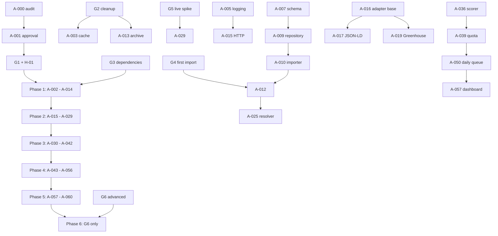

# Master development roadmap

Status: **proposed for G1 approval**.  
Baseline: A-000 audit on **2026-11-06**.  
Scope decisions: Telegram removed; dashboard moved to Phase 5; application submission stays human-only.

## 1. Delivery principles

1. **Safety before features.** A smaller system that cannot submit, contact, or corrupt data is better than a larger one that can.
2. **Offline first.** Every stage is testable with fixtures before any live source is approved.
3. **Read-only inputs.** The master workbook, resume, `profile.yaml`, `answers.yaml`, and `.env` are never written.
4. **One task per session.** Each task ends with evidence, hashes where relevant, and a stop for approval.
5. **No silent failure.** A failed source is recorded, isolated, and surfaced; it never deletes or closes jobs.
6. **Explainable ranking.** Every queued job has a score breakdown and source evidence.
7. **Small queue.** The daily output is a reviewable set, not a dump.

## 2. Phase overview

| Phase | Name | Tasks | Gate to exit | Effort |
|---|---|---|---|---|
| 0 | Audit and approval | A-000, A-001 | G1 + H-01 | Done / 1 owner decision |
| 1 | Foundation and data safety | A-002 - A-014 | Import verified; repository tests pass | 4-6 sessions |
| 2 | Discovery and sources | A-015 - A-029 | Offline adapters pass; one approved live spike | 5-8 sessions |
| 3 | Normalize, classify, score, dedupe | A-030 - A-042 | Pipeline invariants pass; calibration approved | 5-7 sessions |
| 4 | Tracking, Excel, CLI, queue | A-043 - A-056 | End-to-end offline run produces a valid queue and export | 5-7 sessions |
| 5 | Local dashboard | A-057 - A-060 | Dashboard is local-only, DB-only, tested | 3-4 sessions |
| 6 | Deferred advanced features | not assigned | G6 only | Not estimated |

Effort is in agent sessions, not calendar time. It assumes the owner responds to approvals within the same working day.

## 3. Phase 0 - Audit and approval

### Goal

Establish the truth about the current repository and obtain explicit approval to build the target.

### Tasks

| ID | Task | Status |
|---|---|---|
| A-000 | Read-only inventory, claim verification, workbook counts, cleanup manifest, hashes, planning pack | **DONE** after this pack |
| A-001 | Owner review of this pack and confirmation of the authoritative workbook path | **BLOCKED** on G1 + H-01 |

### Exit criteria

- All nine planning documents exist.
- The owner confirms the authoritative workbook path (H-01).
- The owner approves or edits the target architecture and roadmap (G1).
- The owner confirms the Telegram removal and the dashboard move.
- No implementation has started.

### Gate

**G1** plus **H-01**. Until both are complete, Phase 1 does not start.

## 4. Phase 1 - Foundation and data safety

### Goal

Create a safe repository skeleton, a validated configuration layer, a SQLite store, and a read-only company import. Replace the unsafe root entry point only after the new path works.

### Tasks

| ID | Task | Depends on | Acceptance |
|---|---|---|---|
| A-002 | Repository safety baseline: create `job_agent/`, `tests/`, `config/`, `data/`, `docs/`, `archive/`; update `.gitignore`; initialize Git only with owner approval; add example configs | G1 | Private files, workbook, resume, SQLite, logs, and data are ignored; no secrets tracked |
| A-003 | Cleanup Batch 1: move cache files to `archive/legacy_<date>/cache/` or delete with explicit approval | G2 | Import graph unchanged; no cache in the working tree; move log written |
| A-004 | Dependency decision: choose the supported Python version and pin runtime/test dependencies | G1, G3 | A fresh virtualenv installs successfully; no unpinned transitive surprise; owner approves the list |
| A-005 | Logging and redaction: JSON logs, rotation, redaction filter, dry-run guard | G1 | Tests prove emails/phones/tokens/paths are redacted; `dry_run: false` is refused |
| A-006 | Configuration schema: `config.yaml`, `preferences.yaml`, `sources.yaml`, `overrides.yaml`, examples | A-005 | Strict validation; unknown keys rejected; no secrets in YAML; example files contain no personal data |
| A-007 | SQLite schema and migrations: companies, sources, jobs, applications, runs, queue, events | A-006 | Foreign keys on; WAL on; migration from empty DB works; backup before migration |
| A-008 | Canonical schema document and fixture contract | A-007 | `docs/CANONICAL_SCHEMA.md` matches migrations; fixture JSON schema is documented |
| A-009 | Repository layer: typed CRUD, transactions, no raw SQL outside `db/` | A-007, A-008 | Unit tests for each repository method; rollback on error |
| A-010 | Read-only workbook importer for companies | A-009, H-01 | Opens workbook read-only; validates headers; refuses to save; reports per-row errors; hash unchanged |
| A-011 | Company data-quality report | A-010 | Counts by tier, valid URL, ATS type, duplicates, missing IDs; no company names in logs |
| A-012 | First read-only company import into SQLite | A-010, A-011, G4 | Import is idempotent; source workbook hash unchanged; counts match the approved report |
| A-013 | Cleanup Batch 2: archive retired prototypes after replacements exist; remove notify call sites first | G2, A-005, A-009 | Import graph re-run; no live dependents; move log complete; smoke test passes |
| A-014 | Baseline tests and CI: unit tests, lint, typecheck, offline integration harness | A-002 - A-013 | All tests pass offline; CI or a local `make test` / `pytest` command documented |

### Phase 1 exit criteria

- SQLite exists and is backed up.
- The authoritative workbook was imported **read-only** and its hash is unchanged.
- Config validation refuses unsafe settings.
- `dry_run: false` is impossible.
- No private file is tracked by Git.
- The prototype root modules are frozen or archived, never wired to the new pipeline.
- A new contributor can run the offline tests from the README.

## 5. Phase 2 - Discovery and sources

### Goal

Build a bounded, polite, fault-isolated source layer. Prove it with fixtures first, then with one approved read-only live spike.

### Tasks

| ID | Task | Depends on | Acceptance |
|---|---|---|---|
| A-015 | HTTP client: timeout, retries, Retry-After, per-host rate limit, request cap, caching headers | A-005, A-006 | Unit tests with a mock server; no real network in tests; 429/403 handling verified |
| A-016 | Source adapter base and registry: common `fetch`/`parse` contract, error isolation | A-015 | One adapter failure cannot abort a run; registry validates source config |
| A-017 | JSON-LD `JobPosting` adapter | A-016 | Parses a recorded fixture; handles missing fields; no guessing |
| A-018 | Sitemap adapter with lastmod filtering | A-016 | Fixture test; ignores non-job URLs; respects cap |
| A-019 | Greenhouse adapter | A-016 | Fixture test; board token extracted; source ID preserved |
| A-020 | Lever adapter | A-016 | Fixture test; source ID preserved |
| A-021 | Ashby adapter | A-016 | Fixture test; source ID preserved |
| A-022 | SmartRecruiters adapter | A-016 | Fixture test; source ID preserved |
| A-023 | Workable adapter | A-016 | Fixture test; source ID preserved |
| A-024 | Keka and Zoho research plus fixtures | A-016 | Public board pattern documented; fixture captured offline; no live claim |
| A-025 | Company source resolver integration and overrides | A-010, A-016 | Resolution order enforced; override wins; unresolved companies reported |
| A-026 | Source health: success/fail counts, circuit breaker, no job closure on failure | A-016, A-025 | Repeated failures stop that source, not the run; jobs stay active |
| A-027 | Offline adapter tests and fixtures | A-017 - A-024 | Every adapter has a fixture test; errors are isolated; no network |
| A-028 | Source coverage report | A-025 | Counts by source type, resolved/unresolved, disabled, failed; no company names in logs |
| A-029 | First approved read-only live spike (one source, one company set, capped) | G5, A-015 - A-028 | Terms noted; request cap respected; results labeled `LIVE`; no writes to the workbook; stop on block |

### Phase 2 exit criteria

- All adapters pass offline fixture tests.
- The resolver has an explicit override path.
- A source failure cannot close or delete jobs.
- One live spike is documented with source terms, request count, status codes, and observed data quality.
- No portal login, CAPTCHA bypass, or restricted-portal scraping exists.

### Gate

**G5** is required for A-029 and any later live work. A fixture pass is not a live pass.

## 6. Phase 3 - Normalize, classify, score, dedupe

### Goal

Convert raw candidates into validated, classified, deduplicated, explainably scored jobs.

### Tasks

| ID | Task | Depends on | Acceptance |
|---|---|---|---|
| A-030 | Normalizer: whitespace, HTML stripping, URL resolution, canonicalization, date parsing, bounded text | A-008 | Pure-function tests; root-relative URLs preserved; tracking parameters removed |
| A-031 | Validator: required fields, URL sanity, date sanity, reason codes | A-030 | Rejections carry a reason; no exception on malformed input |
| A-032 | Experience classifier | A-031 | Internship/fresher/0-1/1-2/2-3/3plus/unknown; ambiguous -> unknown |
| A-033 | Software vs non-software classifier | A-031 | Word-boundary matching; false positives (`sales engineer`, `accountant`) rejected; evidence stored |
| A-034 | Work mode and country eligibility | A-031 | Explicit-only inference; unknown stays unknown; no city-only country guess |
| A-035 | Skill extraction with word boundaries | A-031 | `C++`, `C#`, `.NET`, `Node.js` handled; required vs preferred; evidence stored |
| A-036 | Gated scorer with breakdown | A-032 - A-035 | Weights sum to 100; missing data scores 0; non-software has no score; deterministic |
| A-037 | Three-layer dedupe | A-009, A-030 | Source ID, canonical URL, fingerprint; possible duplicates flagged, not merged |
| A-038 | Applied-history and manual suppression | A-009, A-037 | Applied jobs never re-enter the queue; suppression is auditable |
| A-039 | Quota selector | A-036 - A-038 | Per-tier/day/company caps; rejects never fill quota |
| A-040 | Pipeline orchestration and run record | A-030 - A-039 | One run transaction; counters match; failure isolation |
| A-041 | Offline pipeline integration tests | A-030 - A-040 | Fixture run produces expected queue; invariants tested |
| A-042 | Scoring calibration review with owner | A-036, A-041, H-xx | Owner reviews sample fixture rankings; weights approved or changed in writing |

### Phase 3 exit criteria

- Non-software roles are rejected before scoring.
- Skills require text evidence.
- Dedupe layers 1-3 pass tests.
- Applied history blocks re-entry.
- The daily queue is capped and explainable.
- The owner approves the scoring defaults (the weights in this pack are proposals, not approved values).

## 7. Phase 4 - Tracking, Excel, CLI, and daily queue

### Goal

Make the pipeline usable end-to-end offline, with a human-owned application log and a safe Excel export.

### Tasks

| ID | Task | Depends on | Acceptance |
|---|---|---|---|
| A-043 | Application tracking repository and status transitions | A-009 | Manual statuses; timestamps; notes; no auto-apply |
| A-044 | Queue state and append-only queue events | A-009, A-039 | Every state change has an actor and timestamp |
| A-045 | Excel exporter from SQLite to a new file | A-043, A-044 | Never opens the master; refuses overwrite without `--force`; writes to `data/exports/` only |
| A-046 | Export validation and hash checks | A-045 | Export opens and validates; master hash unchanged; export hash recorded |
| A-047 | CLI: `run`, `report`, `import-companies`, `export`, `db-check` | A-040, A-043 - A-046 | Non-interactive; `--dry-run` is the only mode; `--live` exits non-zero |
| A-048 | Scheduler-safe launchers | A-047 | No `pause`; logs; non-zero on failure; dry-run only |
| A-049 | Daily run report | A-040, A-047 | Counts, failures, top rejects, queue size; no PII |
| A-050 | Daily queue generation | A-039, A-044, A-049 | Queue persisted; rank, score, reason; applied/duplicate/suppressed excluded |
| A-051 | End-to-end offline integration test | A-047 - A-050 | Fixture sources -> queue -> export; invariants pass; no network |
| A-052 | SQLite backup and restore | A-007, A-043 | Backup before migration; restore tested; no workbook dependency |
| A-053 | **REMOVED**: Telegram notifications and related config | - | Removed by owner decision; do not implement |
| A-054 | Operator runbook and README rewrite | A-047 - A-052 | Install, test, import, run, export, dashboard; no PII; no overclaims |
| A-055 | Performance and request-cap review | A-049 - A-051 | Bounded run time; caps documented; no unbounded fetch |
| A-056 | Scheduled dry-run rehearsal | A-048, A-051, A-055 | One scheduled offline run; logs and run record verified; no network |

### Phase 4 exit criteria

- An offline fixture run produces a valid daily queue and a valid Excel export.
- The master workbook hash is unchanged.
- The CLI refuses live mode.
- The application log is human-owned and auditable.
- The scheduler works without prompts.
- Telegram is absent from code, config, docs, and tests.

## 8. Phase 5 - Local dashboard

### Goal

Provide a local-only review interface over SQLite. The dashboard is a review tool, not an automation trigger.

### Tasks

| ID | Task | Depends on | Acceptance |
|---|---|---|---|
| A-057 | Dashboard skeleton: app factory, `127.0.0.1` binding, read-only Queue and Job Detail pages | A-043 - A-050, G3 | Refuses non-local host; reads only through `queries.py`; no workbook access; no outbound network |
| A-058 | Write actions: status, notes, suppression, applied log; audit events | A-057, A-043, A-044 | Only DB writes; actor and timestamp recorded; no submission or contact |
| A-059 | Sources, runs, rejections, and export pages | A-057, A-028, A-049, A-045 | Read-only source health; export writes a new file only; master untouched |
| A-060 | Dashboard tests, no-network guard, and docs | A-057 - A-059 | Mocked HTTP layer asserts zero outbound calls; local binding test; README updated |

### Phase 5 exit criteria

- Dashboard starts only on `127.0.0.1`.
- It never opens the workbook, never reads `profile.yaml`/`answers.yaml`, and never shows secrets.
- Every write is a database update with an audit event.
- There is no “run discovery” or “apply” button.
- Tests prove no outbound network call.
- The owner can review the daily queue, update statuses, and generate an export without touching Excel.

## 9. Phase 6 - Deferred advanced features

Not assigned task IDs and not estimated. Requires **G6** after Phase 5 is stable.

Candidates:

- optional email or desktop notification digest
- saved dashboard views and filters
- richer ATS coverage
- duplicate-review UI
- analytics on conversion and source quality
- multi-profile support (only if the single-owner privacy model can be preserved)

No Phase 6 feature may reintroduce Telegram, auto-apply, recruiter contact, restricted-portal scraping, or remote dashboard access.

## 10. Dependency graph

## 11. Cross-cutting workstreams

| Workstream | Required in every phase |
|---|---|
| Safety | No submission/contact; `dry_run` guard; `--live` refusal; dashboard local-only |
| Privacy | No PII in logs/tests/docs; redaction filter; private files ignored |
| Testing | Fixture tests for every adapter and pure function; offline integration; live tests labeled |
| Data integrity | Hash checks for workbook/resume/config; transactions; backups |
| Documentation | Update README, runbook, schema, and task board with every phase |
| Review | One task per session; stop for approval; no scope creep |

## 12. Definition of done for any task

A task is done only when:

1. The acceptance criteria are met.
2. Tests pass offline.
3. No forbidden file was modified.
4. Before/after hashes are recorded for any task touching the workbook, resume, or config.
5. The task board row is updated with evidence.
6. The end-of-session report is delivered.
7. The agent stopped and waited for the next approval.

## 13. Top risks and mitigations

| Risk | Mitigation |
|---|---|
| Accidental live submission | Remove live path; `--live` exits non-zero; no form code; tests assert refusal |
| Master workbook corruption | Read-only import; hash before/after; exporter refuses the master; backups |
| PII leak | Ignore rules; redaction filter; no company/contact rows in logs/tests; privacy review |
| Source breakage | Adapter isolation; circuit breaker; do not close jobs on failure; source health page |
| False positives flood the queue | Hard software filter; word-boundary skills; conservative unknown handling |
| Duplicate jobs | Three layers plus applied history; possible-duplicate flag, not auto-merge |
| Scope creep into Telegram/auto-apply | Written scope decisions; task `REMOVED`; architecture rejects it |
| Dependency breakage on Python 3.15 | A-004 owner-approved pins; virtualenv; CI |
| Dashboard exposure | `127.0.0.1` only; no remote host; no network calls; tests |
| Unclear authoritative workbook | H-01 explicit path; no auto-search; import report before use |

## 14. Immediate next step

A-002 and A-003 are complete. Await **G3** approval for **A-004 (dependency decision and pinned requirements)** only. Do not start A-004 through A-060 in the same session. Each task ends with the required report and a stop.
