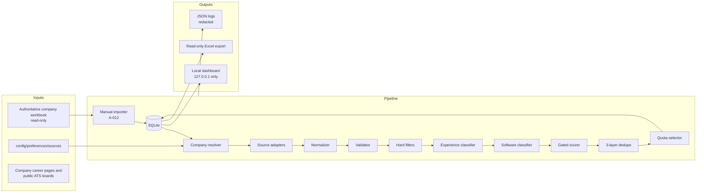

# Target architecture

Status: **proposed for G1 approval**. This is a design document, not permission to implement.  
Core decisions already made by the owner: **Telegram is removed**, **application submission stays human-only**, and the **local dashboard is the primary interface** (Phase 5).

## 1. Goals

1. Discover fresher and internship software jobs from company career pages and public ATS boards.
2. Normalize, validate, classify, and score them consistently.
3. Deduplicate across sources and against already-tracked jobs.
4. Produce a small, ranked daily queue instead of an unfiltered dump.
5. Keep a local, queryable history in SQLite.
6. Export to Excel without ever writing the authoritative workbook.
7. Provide a local dashboard for review, status updates, notes, and exports.
8. Keep the system safe by construction: no submission, no recruiter contact, no portal login, no CAPTCHA bypass, and no live mode.

## 2. Non-goals

- Auto-apply or auto-message.
- LinkedIn, Indeed, Glassdoor, or Naukri scraping.
- Account creation, login automation, or CAPTCHA solving.
- Cloud hosting, multi-user accounts, or remote access.
- Telegram or any chat-bot integration.
- Email/desktop notifications in the current scope.
- Writing the master workbook from the dashboard or the pipeline.
- Perfect recall. Precision and explainability matter more than volume.

## 3. System context



The master workbook is an **input only**. The dashboard and the Excel export read the database. They never write the workbook.

## 4. Data flow

1. **Import companies** (manual, approved): read the authoritative workbook, validate headers, upsert companies into SQLite. Never modify the workbook.
2. **Resolve sources**: for each company, choose the best source URL in this order:
   1. owner override in `config/overrides.yaml`
   2. known ATS link on the careers page
   3. direct careers page
   4. sitemap
   5. approved email alert
   6. manual review
3. **Fetch**: source adapter fetches with a timeout, rate limit, Retry-After, and a request cap.
4. **Parse**: adapter returns raw candidates in a common shape.
5. **Normalize**: trim, collapse whitespace, resolve URLs, canonicalize, parse dates, infer work mode/country.
6. **Validate**: reject records with missing title/company/URL, malformed URL, or duplicate source ID. Record the reason.
7. **Hard filter**: reject non-software roles, roles above the configured experience ceiling, ineligible country/location, closed jobs, and suppressed companies.
8. **Classify**: experience level, software/non-software category, work mode, country eligibility. Store the evidence.
9. **Score**: compute a 0-100 score with a stored breakdown. Scoring is a pure function; no side effects.
10. **Dedupe**: three layers plus applied-history and manual suppression checks.
11. **Select**: enforce per-tier and total daily quotas; rank by score, tier, recency, and company diversity.
12. **Persist**: upsert jobs, update `last_seen_at`, record the run and queue.
13. **Review**: the dashboard shows the queue; the owner marks `Interested`, `Applied`, `Skipped`, `Rejected`, or `Archived`.
14. **Export**: write a new Excel export from SQLite on demand; never touch the master workbook.

## 5. Repository layout

```text
job-agent/
├── config/
│   ├── config.yaml
│   ├── preferences.yaml
│   ├── preferences.example.yaml
│   ├── profile.yaml                # ignored, private
│   ├── profile.example.yaml
│   ├── answers.yaml                # ignored, private
│   ├── answers.example.yaml
│   ├── sources.yaml
│   └── overrides.yaml
├── job_agent/
│   ├── __init__.py
│   ├── cli.py
│   ├── config.py
│   ├── logging_setup.py
│   ├── http_client.py
│   ├── db/
│   │   ├── models.py
│   │   ├── repository.py
│   │   ├── migrations/
│   │   └── backup.py
│   ├── companies/
│   │   ├── importer.py
│   │   ├── resolver.py
│   │   └── overrides.py
│   ├── sources/
│   │   ├── base.py
│   │   ├── registry.py
│   │   ├── greenhouse.py
│   │   ├── lever.py
│   │   ├── ashby.py
│   │   ├── smartrecruiters.py
│   │   ├── workable.py
│   │   ├── jsonld.py
│   │   ├── sitemap.py
│   │   └── email_alerts/
│   ├── pipeline/
│   │   ├── normalize.py
│   │   ├── validate.py
│   │   ├── classify.py
│   │   ├── match.py
│   │   ├── score.py
│   │   ├── dedupe.py
│   │   ├── quota.py
│   │   └── run.py
│   ├── io/
│   │   ├── excel_importer.py
│   │   └── excel_exporter.py
│   ├── tracking/
│   │   ├── applications.py
│   │   └── queue.py
│   └── dashboard/
│       ├── app.py
│       ├── queries.py
│       ├── pages/
│       └── actions.py
├── tests/
│   ├── unit/
│   ├── integration_offline/
│   ├── fixtures/
│   └── live_spikes/
├── data/
│   ├── exports/
│   └── job_agent.sqlite3
├── docs/
│   ├── CANONICAL_SCHEMA.md
│   └── ats_patterns.md
├── project-planning/
├── logs/
├── archive/
├── .env.example
├── .gitignore
├── requirements.txt
└── README.md
```

The root prototype modules are replaced, not extended. They stay frozen until the replacement exists.

## 6. Module responsibilities and contracts

### 6.1 `job_agent/config.py`

- Load YAML with strict schema validation.
- Resolve only explicitly configured paths. Never auto-search for a workbook.
- Refuse `dry_run: false`.
- Refuse a dashboard host other than `127.0.0.1`.
- Redact sensitive values in `repr` and logs.
- Load secrets from environment only; never persist them.

### 6.2 `job_agent/db/`

- SQLite with migrations, foreign keys, and WAL mode.
- One repository object per run; all writes in transactions.
- No raw SQL in the dashboard.
- Backup the database file before migrations.
- Never store resume text, profile answers, or secrets in SQLite.

### 6.3 `job_agent/companies/`

- `importer.py`: read-only workbook import, header validation, row-level error report.
- `resolver.py`: source resolution order above.
- `overrides.py`: owner-maintained company-to-source mapping; overrides beat heuristics.

### 6.4 `job_agent/sources/`

Every adapter implements the same contract:

```python
class SourceAdapter(Protocol):
    source_type: str

    def fetch(self, source: SourceRef, client: HttpClient) -> FetchResult: ...
    def parse(self, payload: bytes, source: SourceRef) -> list[RawJob]: ...
```

Rules:

- One adapter failure returns a `FetchResult` with `ok=False` and an error; it never raises into the run.
- Honor `robots.txt`, `Retry-After`, timeouts, and per-host rate limits.
- No login, no CAPTCHA, no stealth, no proxy rotation.
- Record HTTP status, elapsed time, and a redacted URL.
- A failed fetch must not deactivate or delete existing jobs.

### 6.5 `job_agent/pipeline/`

- `normalize.py`: pure functions; no I/O.
- `validate.py`: pure functions; returns `(accepted, rejected_with_reasons)`.
- `classify.py`: pure functions; returns enums plus evidence strings.
- `match.py`: pure hard filters; returns accept/reject plus reason.
- `score.py`: pure; returns `ScoreResult(total, breakdown, reasons)`.
- `dedupe.py`: pure key and fingerprint functions; database lookups are passed in.
- `quota.py`: pure selection; DB reads are passed in.
- `run.py`: orchestration only; owns the transaction boundaries and run record.

### 6.6 `job_agent/io/`

- `excel_importer.py`: read-only import from the authoritative workbook.
- `excel_exporter.py`: creates a **new** export file from SQLite. Refuses to open the master workbook, refuses an existing export unless `--force`, and never writes formulas into the master.
- Export sheets: `Daily Queue`, `All Jobs`, `Applications`, `Companies`, `Runs`, `Rejected`. The master workbook remains the owner's source of truth for companies, not jobs.

### 6.7 `job_agent/tracking/`

- Application status transitions with timestamps and notes.
- Queue state: `queued`, `reviewed`, `interested`, `applied`, `skipped`, `rejected`, `archived`.
- Applied-history check: a canonical URL or source ID already marked applied must not re-enter the daily queue.
- Manual suppression: company or job can be suppressed with a reason.

### 6.8 `job_agent/dashboard/` (Phase 5)

- Streamlit app bound to `127.0.0.1` only. Refuse any other host.
- Read-only pages first: Queue, Job detail, Applications, Sources, Runs, Rejected, Settings.
- Write actions limited to database updates: status, notes, suppression, export trigger.
- No workbook access, no resume upload, no portal fetch, no network call to job sources.
- No “Run discovery now” button. Running discovery stays a CLI action with explicit approval and caps.
- Every write shows the actor (`owner`) and a timestamp.
- The app must not display secrets, `profile.yaml`, `answers.yaml`, or resume contents.

## 7. Canonical database schema

Proposed SQLite tables. Exact column names are fixed by `docs/CANONICAL_SCHEMA.md` in A-008.

### 7.1 `companies`

| Column | Type | Notes |
|---|---|---|
| `master_id` | INTEGER PK | From workbook column N |
| `name` | TEXT | Company name |
| `tier` | TEXT | Tier 1-4 |
| `careers_url` | TEXT | Workbook column H hyperlink target |
| `openings_url` | TEXT | Workbook column I |
| `ats_type` | TEXT | `greenhouse`, `lever`, `ashby`, `smartrecruiters`, `workable`, `keka`, `zoho`, `jsonld`, `sitemap`, `unknown` |
| `ats_identifier` | TEXT | Board token or tenant |
| `resolution_status` | TEXT | `unresolved`, `resolved`, `manual`, `failed` |
| `last_resolved_at` | TEXT | ISO 8601 UTC |
| `notes` | TEXT | Owner notes |

### 7.2 `sources`

| Column | Type | Notes |
|---|---|---|
| `source_id` | INTEGER PK | |
| `company_master_id` | INTEGER FK | |
| `source_type` | TEXT | Adapter name |
| `url` | TEXT | Unique per company |
| `enabled` | INTEGER | 0/1 |
| `last_run_at` | TEXT | |
| `last_status` | TEXT | `ok`, `http_error`, `parse_error`, `blocked`, `skipped` |
| `etag` | TEXT | Cache validator |
| `last_modified` | TEXT | Cache validator |
| `fail_count` | INTEGER | Reset on success |

### 7.3 `jobs`

| Column | Type | Notes |
|---|---|---|
| `job_id` | INTEGER PK | |
| `source_id` | INTEGER FK | |
| `company_master_id` | INTEGER FK | Nullable only if unresolved |
| `source_job_id` | TEXT | ATS ID if available |
| `canonical_url` | TEXT | Unique after canonicalization |
| `apply_url` | TEXT | May equal canonical URL |
| `title` | TEXT | |
| `company_name` | TEXT | Denormalized for display |
| `location_raw` | TEXT | |
| `city` | TEXT | |
| `region` | TEXT | |
| `country` | TEXT | ISO code where possible |
| `work_mode` | TEXT | `onsite`, `hybrid`, `remote`, `unknown` |
| `employment_type` | TEXT | `internship`, `full_time`, `contract`, `unknown` |
| `experience_level` | TEXT | Enum below |
| `is_internship` | INTEGER | 0/1 |
| `is_software` | INTEGER | 0/1 |
| `software_evidence` | TEXT | Matched terms |
| `skills_required` | TEXT | JSON array |
| `skills_preferred` | TEXT | JSON array |
| `description_text` | TEXT | Bounded length; no HTML |
| `posted_at` | TEXT | Nullable |
| `discovered_at` | TEXT | |
| `last_seen_at` | TEXT | |
| `status` | TEXT | `active`, `closed`, `expired`, `unknown` |
| `score_total` | INTEGER | 0-100 |
| `score_breakdown` | TEXT | JSON |
| `dedupe_key` | TEXT | Layer 1/2 key |
| `fingerprint` | TEXT | Layer 3 key |
| `is_active` | INTEGER | 0/1 |
| `created_at` | TEXT | |
| `updated_at` | TEXT | |

Unique constraints: `(source_id, source_job_id)` when `source_job_id` is not null; `canonical_url`; `dedupe_key`; `fingerprint`.

### 7.4 `applications`

| Column | Type | Notes |
|---|---|---|
| `application_id` | INTEGER PK | |
| `job_id` | INTEGER FK | |
| `status` | TEXT | Human-owned status |
| `applied_at` | TEXT | Owner-entered date |
| `notes` | TEXT | |
| `proof_path` | TEXT | Owner-supplied path; never generated by the system |
| `created_at` | TEXT | |
| `updated_at` | TEXT | |

### 7.5 `daily_runs`

| Column | Type | Notes |
|---|---|---|
| `run_id` | INTEGER PK | |
| `started_at` | TEXT | |
| `finished_at` | TEXT | |
| `mode` | TEXT | Always `dry` |
| `source_count` | INTEGER | |
| `fetched_count` | INTEGER | |
| `normalized_count` | INTEGER | |
| `rejected_count` | INTEGER | |
| `duplicate_count` | INTEGER | |
| `queued_count` | INTEGER | |
| `errors_json` | TEXT | Redacted |

### 7.6 `queue` and `queue_events`

`queue` holds the current daily selection with rank, score, reason, and state. `queue_events` is an append-only audit of state changes with timestamp, old state, new state, and note.

### 7.7 `schema_migrations`

Standard migration version table. Migrations are forward-only in development; production changes require a backup and a rollback note.

## 8. Normalization rules

- Trim and collapse whitespace in all text.
- Strip HTML tags; keep readable text only.
- Resolve all URLs with `urljoin`; keep both absolute and root-relative URLs.
- Strip tracking parameters (`utm_*`, `gclid`, `fbclid`, `ref`, `source`) from canonical URLs.
- Lowercase the host; remove default ports; keep meaningful path/query.
- Parse dates to UTC ISO 8601. Store `unknown` when absent; do not guess.
- Infer country from explicit text only; never guess from city alone.
- Keep `location_raw` for transparency.
- Bound `description_text` to a configured maximum (for example 20,000 characters) and record truncation.

## 9. Classification rules

### 9.1 Software vs non-software

A job is software only if the title or description contains a software term on a word boundary. Examples: `software`, `developer`, `engineer`, `programmer`, `SDE`, `frontend`, `backend`, `full stack`, `data`, `ML`, `DevOps`, `QA`, `SRE`, `cloud`.

Negations and false positives must be handled: `sales engineer`, `support engineer`, `civil engineer`, `mechanical engineer`, `network engineer` (unless software context), `accountant`, `recruiter`, `designer` (unless product/UX with software context).

- If uncertain, classify `non-software` and send to manual review; never inflate the queue.
- Store the matched evidence terms.
- A non-software role is a hard reject, not a low score.

### 9.2 Experience level

Enum: `internship`, `fresher`, `0-1`, `1-2`, `2-3`, `3plus`, `unknown`.

Rules:

- Internship if the title or type says intern/internship/trainee.
- Fresher if the text says fresher, graduate, entry level, 0-1 years, or no experience required.
- Parse explicit ranges with a conservative parser. If multiple ranges appear, use the minimum required experience.
- If ambiguous, `unknown` and manual review.
- The candidate profile ceiling is configurable; the default proposal is **2 years**. This is a proposed default, not an owner-approved value.

### 9.3 Work mode and country eligibility

- Work mode: explicit `remote`, `hybrid`, `onsite`; otherwise `unknown`.
- Country: explicit country/region; otherwise `unknown`.
- Eligibility accepts the configured countries/regions and `remote` roles that do not restrict to an ineligible country.
- No guessing from timezone or currency.

## 10. Skill extraction

- Normalize skill names from `config/preferences.yaml` (for example `js` -> `javascript`, `node` -> `node.js`).
- Match on word boundaries with Unicode-aware regex; escape special characters.
- Treat `C++`, `C#`, `.NET`, `Node.js`, and similar tokens explicitly.
- Required vs preferred skills come from explicit section headings when possible; otherwise from a bounded keyword scan.
- Store matched skills and the text span or section as evidence.
- Never award skill points for a skill that is not present in the job text.

## 11. Scoring

Proposed defaults for owner review; **not yet approved**:

| Factor | Weight | Notes |
|---|---:|---|
| Role/title fit | 30 | Software role family match |
| Required skills overlap | 25 | Word-boundary matches only |
| Experience fit | 20 | Fresher/0-1/1-2 scores highest |
| Location/eligibility | 10 | Configured cities/countries; remote eligible |
| Education fit | 5 | Degree/branch match |
| Company tier | 5 | Tier 1 highest |
| Recency | 5 | Newer is better; unknown gets 0 |

Rules:

- Hard filters run before scoring. A rejected job gets no score.
- The score is an integer 0-100 with a JSON breakdown and human-readable reasons.
- Missing data scores 0 for that factor; it never scores full marks.
- The scorer is deterministic and side-effect free.
- Weights live in `config/preferences.yaml`, validated to sum to 100.
- A score is a sorting aid, not a truth claim. The dashboard shows the breakdown.

## 12. Deduplication

Three layers, in order:

1. **Source identity**: `(source_id, source_job_id)` when the ATS provides an ID.
2. **Canonical URL**: normalized URL after tracking-parameter removal.
3. **Fingerprint**: normalized `company + title + location + description similarity` (for example a shingle/simhash fingerprint).

Additional checks:

- Applied-history: canonical URL, source ID, or fingerprint already applied -> exclude from the daily queue and mark `already_applied`.
- Manual suppression: company or job suppressed -> exclude.
- Fuzzy review: if two records are similar above a threshold but not equal, keep both and flag `possible_duplicate` for the dashboard; never auto-merge across companies.

## 13. Quota selection

- Hard caps per tier and per day, configured in `preferences.yaml`.
- Rank by score, then tier, then recency, then company diversity.
- At most N roles per company per day (proposed default 2).
- Never fill the quota with rejected, duplicate, applied, or suppressed jobs.
- The output is small enough for a human to review: proposed default 20-30 roles/day, owner-configurable.

## 14. Source resolution and ATS adapters

Resolution order:

1. `config/overrides.yaml`
2. known ATS link found on the careers page
3. direct careers page
4. sitemap
5. approved email alert
6. manual review

Adapters are added only when fixtures and a live spike are approved. Each adapter needs:

- a recorded fixture for offline tests
- a documented URL pattern
- a rate limit and request cap
- a failure mode that does not close jobs
- a `LIVE` spike note with source terms and observed status

Initial adapter candidates: Greenhouse, Lever, Ashby, SmartRecruiters, Workable, JSON-LD, sitemap. Keka and Zoho are present in the current workbook and need fixtures before implementation.

## 15. Excel boundary

- The authoritative workbook is read-only.
- The importer opens it with `read_only=True` and `data_only=False` where formulas must not be evaluated, and never saves it.
- The exporter writes a **new** file in `data/exports/` from SQLite.
- The exporter refuses to overwrite the master or any path outside `data/exports/`.
- The dashboard has no Excel write action.
- A workbook hash check runs before and after import/export tasks.

## 16. Dashboard design (Phase 5)

Pages:

1. **Daily Queue** - ranked jobs, score breakdown, source, tier, location, status actions.
2. **Job Detail** - description excerpt, evidence, links, notes, status history.
3. **Applications** - human-owned application log; manual entry only.
4. **Companies & Sources** - resolution status, last run, fail count, override editor.
5. **Runs & Rejections** - run stats, rejection reasons, failed sources.
6. **Exports** - generate a new Excel export; show the path and hash.
7. **Settings** - read-only display of config and preferences; secrets redacted.

Safety:

- Bind `127.0.0.1`; refuse `0.0.0.0`.
- No outbound network calls; tests mock the HTTP layer and assert zero calls.
- No submission, no recruiter contact, no resume upload.
- No workbook read or write.
- Writes go through `tracking/` and `db/repository.py` with an audit event.
- The dashboard is a review tool, not an automation trigger.

## 17. Logging, errors, and observability

- JSON lines to `logs/job_agent.log` with rotation.
- Fields: timestamp, level, run_id, stage, source, company_master_id, job_id, event, duration_ms, error_type.
- Redaction filter for emails, phone numbers, tokens, cookies, and absolute user paths.
- Per-source error records; one failure does not abort the run.
- Run summary written to `daily_runs` and the dashboard.
- No company names or contact details in error messages when a count suffices.

## 18. Configuration

| File | Purpose | Private? |
|---|---|---|
| `config/config.yaml` | Runtime paths, limits, logging, dashboard host | No |
| `config/preferences.yaml` | Roles, skills, weights, tiers, quotas, locations, experience ceiling | No |
| `config/sources.yaml` | Per-source enable flags, caps, terms notes | No |
| `config/overrides.yaml` | Company-to-source manual mappings | No |
| `config/profile.yaml` | Owner profile | **Yes** |
| `config/answers.yaml` | Owner application answers | **Yes** |
| `.env` | Secrets, if any | **Yes** |

`profile.example.yaml`, `answers.example.yaml`, and `preferences.example.yaml` are blank templates with no personal data.

## 19. Security and privacy

- Secrets only in environment variables; never in YAML, SQLite, logs, or the dashboard.
- `.env`, `profile.yaml`, `answers.yaml`, the resume, the workbook, `data/`, and `logs/` are ignored by Git.
- File permissions restricted where the OS supports it.
- No remote dashboard binding.
- No PII in tests or fixtures. Use synthetic names and `example.com` only in fixtures, clearly labeled.
- Redaction is tested.

## 20. Scheduling

- The CLI is non-interactive and returns a non-zero exit code on failure.
- A scheduler runs `python -m job_agent.cli run --dry-run` with approved caps.
- No `pause`, no prompt, no auto-open.
- Logs and the run record show the scheduled run.
- Live discovery is disabled by default; a scheduled run uses cached/fixture sources or approved read-only sources only.

## 21. Migration map from the prototype

| Prototype | Target | Decision |
|---|---|---|
| `main.py` | `job_agent/cli.py` + `pipeline/run.py` | Replace |
| `discover.py` | `job_agent/sources/*` + `companies/resolver.py` | Replace |
| `match.py` | `pipeline/classify.py`, `match.py`, `score.py`, `dedupe.py` | Replace |
| `excel_io.py` | `db/repository.py`, `io/excel_importer.py`, `io/excel_exporter.py` | Replace |
| `notify.py` | none | Archive; Telegram removed |
| `apply.py` | none | Archive; human-assisted only |
| `create_tracker.py`, `add_companies.py`, `clear_tracker.py` | none | Archive |
| local starter workbook | authoritative workbook via explicit config | Archive after H-01 |
| `config.yaml` | `config/config.yaml` + `preferences.yaml` | Modify/move later |
| `requirements.txt` | pinned runtime requirements | Modify |
| `README.md` | rewritten README | Replace |

## 22. Acceptance invariants

The target architecture is acceptable only if all of these hold:

1. `dry_run` is always true; no live submission path exists.
2. The master workbook, resume, `profile.yaml`, `answers.yaml`, and `.env` are never written.
3. A source failure cannot delete, close, or overwrite jobs.
4. Non-software roles are rejected before scoring.
5. Skill scores require word-boundary evidence from the job text.
6. Every queued job has a stored score breakdown and source.
7. Duplicate layers 1-3 are enforced by tests.
8. Applied jobs do not re-enter the queue.
9. The dashboard binds only to `127.0.0.1` and makes no outbound network calls.
10. The dashboard never opens the workbook.
11. All tests are offline by default; live tests are labeled and gated.
12. Secrets and PII are redacted from logs and reports.
