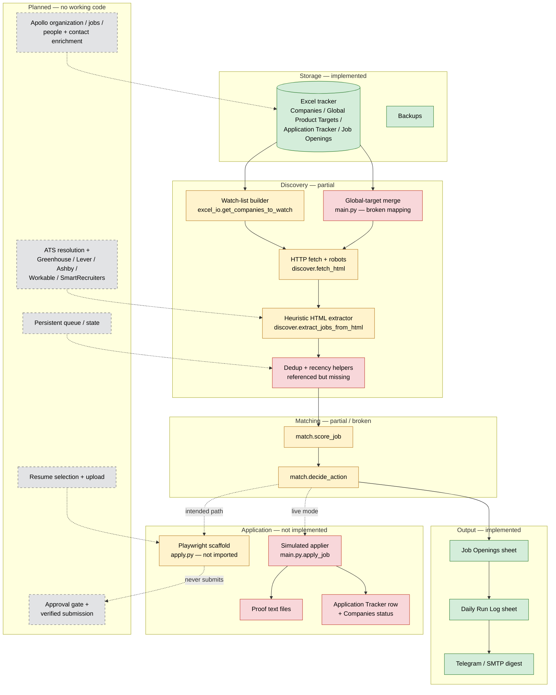

# Job Application Automation Agent — Technical Project Overview

**Project name (generic):** Job Application Automation Agent (`job-agent`)
**Report type:** Read-only technical audit and status report
**Audit date:** 2026-11-06
**Audience:** Developers, AI assistants, mentors, collaborators
**Privacy status:** Sanitized. Identities, credentials, local paths, resume contents, and company/contact records are excluded. Aggregate counts and module names only.

> **Evidence key**
> - **[CODE]** verified by reading the current source/configuration.
> - **[EXEC]** verified by executing a bounded, read-only check during this audit.
> - **[DOC]** stated in project documentation only; not confirmed in current code.
> - **[UNVERIFIED]** implementation exists but could not be executed safely, or the claim could not be reproduced.
> - **[ABSENT]** no implementation found.

---

## A. Project Overview

### Purpose

`job-agent` is a local Python automation prototype intended to run a daily job-search pipeline:

1. Read a target-company list from an Excel tracker.
2. Visit company career pages and extract job postings.
3. Filter and score postings for fresher/entry-level software roles.
4. Store results in Excel.
5. Optionally prepare or submit applications through ATS forms.
6. Send a daily summary through Telegram or email.

### Problem it addresses

Manual job discovery is repetitive: a candidate must visit many career pages, compare roles against skills and experience, avoid duplicates, track applications, and keep the spreadsheet current. The project aims to centralize that loop in one scheduled local agent while keeping Excel as the source of truth.

### Target users

- Individual job seekers running a local, single-user workflow.
- Developers who want an inspectable, policy-conscious job-search pipeline.
- Collaborators extending ATS adapters or matching logic.

### Main use cases

- Build a daily watch list from an existing company spreadsheet.
- Crawl company career pages and collect candidate job links.
- Score and rank postings against a profile.
- Log discovered jobs and daily run statistics.
- Notify the operator of matched or manual-apply jobs.
- (Planned) discover HR contacts and prepare applications.

### Key differentiators claimed by the project

- Excel remains the single source of truth.
- Explicit dry-run mode and backup-before-write behavior.
- Policy-aware split between automated ATS forms and manual platforms.
- Local-only storage; no hosted database required.

### Current reality

The project is an **early-stage prototype**, not a working end-to-end job agent. The Excel I/O layer is the most mature part. Discovery is a generic HTML scraper with incomplete helpers. Matching contains two blocking defects. Application submission is simulated. ATS API integrations, Apollo/contact discovery, resume routing, approval workflow, and persistent queue are not implemented. See Sections D, G, and H.

---

## B. Technology Stack

Versions below are the ones actually observed in the audit environment or pinned in `requirements.txt`. Discrepancies are noted.

| Technology / library | Actual version observed | Pinned version | Purpose | Implementation status |
|---|---:|---:|---|---|
| Python | 3.15.0 | not pinned | Runtime | Runs; several pinned packages are not installed; 3.15 compatibility is unverified |
| `openpyxl` | 3.1.5 | 3.1.2 | Excel read/write, styling, data validation | Used; core Excel layer works |
| `PyYAML` | 6.0.3 | 6.0.1 | Read `config.yaml`, `profile.yaml`, `answers.yaml` | Used |
| `python-dotenv` | 1.2.4 | 1.0.0 | Load `.env` | Used |
| `requests` | 2.34.2 | 2.31.0 | HTTP fetch, Telegram API | Used |
| `beautifulsoup4` | 4.15.0 | 4.12.2 | HTML parsing | Used with `html.parser` |
| `lxml` | 6.1.3 | 4.9.3 | HTML parser backend | Installed but not used by current parser |
| `playwright` | **missing** | 1.40.0 | Browser automation for applications | Not usable in current environment |
| `Pillow` | **missing** | 10.1.0 | Image handling | Not imported by current code |
| `schedule` | **missing** | 1.2.0 | In-process scheduling | Not imported by current code |
| `python-dateutil` | **missing** | 2.8.2 | Date utilities | Not imported by current code |
| `rich` | **missing** | 13.7.0 | Terminal formatting | Not imported by current code |
| `pytest` | **missing** | not listed | Test runner | No tests exist |
| Telegram Bot API | HTTP via `requests` | n/a | Notifications | Implemented, environment-driven |
| SMTP (stdlib `smtplib`) | stdlib | n/a | Email notifications | Implemented, disabled by config default |
| Excel `.xlsx` | local file | n/a | Primary persistent store | Implemented |
| Database | none | n/a | Persistent storage | Not used |
| Web framework | none | n/a | API/UI | Not used |
| LLM / AI service | none | n/a | Matching or cover letters | Not used |
| Apollo API | none | n/a | Contact enrichment | Not implemented; environment key unused |

**Dependency findings [EXEC]:** `openpyxl`, `PyYAML`, `python-dotenv`, `requests`, `beautifulsoup4`, and `lxml` import successfully. `playwright`, `Pillow`, `schedule`, `python-dateutil`, `rich`, and `pytest` are not installed. The pinned versions are older than the installed versions, and several 2023-era pins are unlikely to have Python 3.15 wheels.

---

## C. System Architecture

### Architectural style

- Single-process, command-line Python application.
- Module-level coupling through direct imports (`excel_io`, `discover`, `match`, `notify`).
- File-based persistence (Excel, YAML, optional proof files).
- Synchronous, sequential company-by-company processing.
- No service layer, database, message queue, or web UI.

### Major components

| Component | Module | Responsibility | State |
|---|---|---|---|
| Orchestrator | `main.py` | CLI, lock, watch list, pipeline stages, Excel updates, stats | Partial |
| Excel I/O | `excel_io.py` | Backup, load/save, sheet creation, dedup keys, row append/update | Implemented core |
| Discovery | `discover.py` | HTTP fetch, robots check, heuristic HTML job extraction | Partial / broken helpers |
| Matching | `match.py` | Role relevance, experience filter, scoring, decision | Partial / blocking defects |
| Application scaffold | `apply.py` | Playwright browser, ATS sniffing, field fill, manual alerts | Partial, not wired, never submits |
| Notifications | `notify.py` | Telegram digest, SMTP email, manual-action alerts | Implemented |
| Configuration | `config.yaml`, `profile.yaml`, `answers.yaml` | Search preferences, applicant data, form answers | Present; sensitive |
| Tracker utilities | `create_tracker.py`, `add_companies.py`, `clear_tracker.py` | Generate/reset/maintain workbook | Dev-only, dangerous hard-coded paths |
| Scheduler helpers | `run_job_agent.bat`, `run_job_agent.sh` | Launch dry runs | Partial |

### Diagram



### What is genuinely connected

- `main.py` imports `excel_io`, `discover`, `match`, and `notify` **[CODE]**.
- `main.py` does **not** import `apply.py`; live mode calls its own simulated `apply_job()` **[CODE]**.
- The workbook is backed up, loaded, extended with two sheets, read for dedup, updated, saved, and logged **[CODE, EXEC]**.
- Career-page discovery is a single GET followed by heuristic anchor/heading parsing; no ATS API is called **[CODE]**.
- No component calls Apollo, any ATS JSON API, or any contact-enrichment service **[CODE]**.

---

## D. Feature Implementation Matrix

Status definitions:
- **IMPLEMENTED** — working implementation verified in code (and, where possible, execution).
- **PARTIAL** — some implementation exists, but behavior is incomplete, incorrect, or unverified.
- **PLANNED** — mentioned in config/docs only.
- **NOT IMPLEMENTED** — no implementation found.
- **UNVERIFIED** — code exists but could not be executed successfully.

| # | Capability | Status | Evidence in current code | Notes |
|---:|---|---|---|---|
| 1 | Company discovery | **NOT IMPLEMENTED** | `excel_io.get_companies_to_watch()` reads existing rows only | No external sourcing, no search, no company enrichment |
| 2 | Career-page crawling | **PARTIAL** | `discover.fetch_html()`, `discover.extract_jobs_from_html()` | HTTP GET + heuristic parsing; relative URLs are discarded; no JS rendering or pagination |
| 3 | ATS detection | **PARTIAL** | `apply.py:detect_ats()` | URL/content sniffing for six ATS names, only during an application attempt; not used by discovery |
| 4 | Greenhouse integration | **NOT IMPLEMENTED** | Strings in `apply.py` allowlist/detection only | No Greenhouse board API, slug resolution, schema parsing, or application handler |
| 5 | Lever integration | **NOT IMPLEMENTED** | Strings in `apply.py` allowlist/detection only | No Lever postings API or handler |
| 6 | Ashby integration | **NOT IMPLEMENTED** | Strings in `apply.py` allowlist/detection only | No Ashby API or handler |
| 7 | Workable integration | **NOT IMPLEMENTED** | Strings in `apply.py` allowlist/detection only | No Workable API or handler |
| 8 | SmartRecruiters integration | **NOT IMPLEMENTED** | Strings in `apply.py` allowlist/detection only | No SmartRecruiters API or handler |
| 9 | Workday and other ATS support | **NOT IMPLEMENTED** | Workday absent from allowlist; Keka/Zoho/Freshteam only as strings | No Workday, iCIMS, Taleo, SuccessFactors support |
| 10 | Job extraction and validation | **PARTIAL** | `discover.extract_jobs_from_html()` | Heuristic anchors/headings; no posted date, no live-posting validation, no schema checks; dedup helpers missing |
| 11 | Fresher/experience filtering | **PARTIAL** | `match._experience_eligible()`, `match.check_eligibility()` | Regex-based; decision path crashes before a result is returned (Section H) |
| 12 | Skill matching | **PARTIAL** | `match._score_skills()` | Scores the configured skill list rather than the job text; every job receives maximum skill points |
| 13 | Job scoring | **PARTIAL** | `match.score_job()` | Runs, but produces inflated scores; a non-software job scored 85 in a bounded test |
| 14 | Resume selection | **NOT IMPLEMENTED** | `config.yaml:resume_paths` only | No code reads, selects, attaches, or uploads a resume; all role keys point to the same file |
| 15 | Apollo organization lookup | **NOT IMPLEMENTED** | `APOLLO_API_KEY` exists in `.env.example` only | Key is never read |
| 16 | Apollo job postings | **NOT IMPLEMENTED** | No code | No Apollo jobs endpoint usage |
| 17 | Apollo HR/recruiter discovery | **NOT IMPLEMENTED** | No code | No people search or contact discovery |
| 18 | Email and phone enrichment | **NOT IMPLEMENTED** | Application Tracker has contact/email columns | No code populates them; profile phone is empty |
| 19 | Excel integration | **IMPLEMENTED** | `excel_io.py` full module | Backup, load, save, sheet creation, append, update; workbook round-trip observed |
| 20 | Queue and deduplication | **PARTIAL** | `excel_io.get_job_openings_keys()`, `get_applied_urls()`, `main.py` dedup block | Dedup helpers (`compute_job_key`, `is_duplicate_job`, `is_posted_recent`) are missing; no persistent queue |
| 21 | Application form preparation | **PARTIAL** | `apply.py:fill_common_fields()`, `check_unknown_questions()` | Name/email/phone only; no resume, EEO, custom fields, or select handling; module not wired |
| 22 | Application submission and approval | **NOT IMPLEMENTED** | `apply.py:fill_and_submit()` always returns `False`; `main.py` simulates success | No approval gate, no real submit, no verified confirmation |
| 23 | Error handling and logging | **PARTIAL** | `try/except` in `main.py`, `discover.py` logger | Errors are printed/swallowed; no file logging, no redaction, no structured errors; `logs/` is empty |

### Additional capabilities observed

| Capability | Status | Evidence |
|---|---|---|
| Backup before write | **IMPLEMENTED** | `excel_io.backup_workbook()` |
| Create `Job Openings` / `Daily Run Log` | **IMPLEMENTED** | `excel_io.ensure_new_sheets()`; both sheets exist in the project workbook |
| Telegram digest / alerts | **IMPLEMENTED** | `notify.py`; environment-driven, ignores `notifications.enabled` |
| SMTP email | **IMPLEMENTED** | `notify.py`; disabled in config |
| CLI modes | **PARTIAL** | `--dry-run`, `--live` honored; `--discover-only` and `--report` parsed but ignored |
| Scheduling helpers | **PARTIAL** | `.bat` / `.sh` always call `--dry-run`; `.bat` waits for a keypress |
| Persistent pending-update queue | **NOT IMPLEMENTED** | `pending_updates.json` named in `main.py`/README but never written |
| Locking | **PARTIAL** | `job_agent.lock` created/removed; no stale-PID validation, no Excel `~$` lock detection |
| Config validation | **NOT IMPLEMENTED** | Live mode only checks the `dry_run` flag |
| Tests | **NOT IMPLEMENTED** | No test files, no `pytest` dependency |
| Logging to file | **NOT IMPLEMENTED** | `logs/` directory exists but is empty |

---

## E. End-to-End Workflow

### E.1 Actual workflow in current code

1. **Startup [CODE].** `main.py` loads `config.yaml`, `profile.yaml`, and `answers.yaml`, then acquires `job_agent.lock`.
2. **Tracker resolution [CODE].** `excel_io.get_tracker_path()` searches the current directory, then the parent directory, then a hard-coded fallback path. The current project directory contains a minimal workbook, so that workbook wins over a richer workbook elsewhere.
3. **Backup [CODE, EXEC].** A same-day copy is written under `backups/`; older copies beyond the retention limit are deleted.
4. **Sheet preparation [CODE, EXEC].** The workbook is loaded and `Job Openings` plus `Daily Run Log` are created if absent.
5. **Watch-list construction [CODE].** Rows from `Companies` with tiers 1–3 and non-terminal statuses are selected. Rows from `Global Product Targets` are appended using the wrong columns (see H).
6. **Per-company discovery [CODE].** For each company, `discover.real_discover_jobs()` fetches `careers_page` with `requests`, checks `robots.txt`, parses HTML with BeautifulSoup, and returns candidate titles/links.
7. **Deduplication and recency [CODE].** `main.py` calls `discover.compute_job_key()`, `discover.is_duplicate_job()`, and `discover.is_posted_recent()`. **All three functions are absent**, so the per-company block raises `AttributeError` and the error is swallowed by the company-level `try/except`.
8. **Scoring [CODE].** If step 7 were fixed, `match.score_job()` would score the candidate. Its skill component ignores the job text, so scores are inflated.
9. **Decision [CODE].** If scoring were reached, `match.decide_action()` calls an undefined symbol and raises `NameError` for any job not rejected by the title/exclusion checks.
10. **Excel write [CODE].** Surviving records would be appended to `Job Openings`.
11. **Live application [CODE].** If live mode is enabled, `main.py.apply_job()` sleeps briefly, writes a text file named `.png` containing the word `proof`, marks the company as applied, and appends an Application Tracker row. No browser is opened and no application is submitted.
12. **Save and log [CODE].** The workbook is saved, a digest is sent, `Daily Run Log` is appended, and the workbook is saved again.

**Net result [EXEC]:** the documented end-to-end workflow cannot currently discover a real job. The pipeline may finish, but only because per-company exceptions are caught and counted; `Job Openings` remains unchanged.

### E.2 Partially working workflow

- Watch-list construction and Excel sheet creation work on a compatible workbook.
- HTTP fetching with retries and robots checking is implemented, subject to the caveats below.
- Absolute-link extraction works on static HTML; relative-link extraction does not.
- Excel backup, row append, and daily logging work.
- Notification functions can send if the relevant environment variables are configured.

### E.3 Planned workflow (not implemented)

```
Company sourcing / ATS resolution
  -> ATS-specific job feeds (Greenhouse, Lever, Ashby, Workable, SmartRecruiters)
  -> schema validation + recency + location/experience filters
  -> job-text skill matching + calibrated scoring
  -> deduplication against all tracker areas
  -> resume selection by role
  -> Apollo organization/jobs/people lookup + email/phone enrichment
  -> application form preparation
  -> approval gate
  -> verified submission + screenshot proof
  -> tracker update + follow-up scheduling
```

---

## F. Data Flow and Storage

### Where company data comes from

- **Excel only.** `Companies` and `Global Product Targets` sheets are read; no external company discovery exists.
- A richer workbook observed in the parent directory contains 693 company rows across a 69-column schema, with tiers 1–4 and all statuses set to `Not Started`. The project-local workbook contains only two sample rows and a 7-column schema.
- `Global Product Targets` stores career links in a cell whose visible text is a label; the URL is held in the Excel hyperlink target. Current code reads the cell value, not the hyperlink.

### How job records are stored

- `Job Openings` sheet, 19 columns: job key, dates, company identity, title, location, work mode, experience, posted date, link, source, score, reasons, decision, skip reason, apply status, date applied, tracker row reference, last checked.
- `Daily Run Log` sheet, 11 columns: run date, mode, companies checked, source failures, jobs found, matched, applied, manual needed, skipped, errors, notes.
- No database, JSON store, or cache is used for job records.

### How duplicate jobs are handled

- Intended: compute a stable job key, compare against keys and URLs in `Job Openings`, and compare URLs against `Application Tracker`.
- Actual: `excel_io` can read existing keys/URLs, and `main.py` contains comparison logic, but the key and recency helpers are missing. Deduplication therefore never executes successfully.
- No URL canonicalization (tracking parameters, trailing slashes, redirects) is implemented.
- No persistent pending-update queue exists.

### How contacts are associated with companies and jobs

- `Application Tracker` has contact columns (first/last name, role, LinkedIn, email, source) plus job title and application URL.
- No code populates those columns from Apollo or any other source.
- No recruiter/contact table is written by the agent. A separate contact sheet exists in the richer parent workbook but is not read by the agent.
- No company–contact–job relationship logic exists.

### How application status is tracked

- `Companies`: only four columns are writable — Application Status, Date Applied, Next Action Date, My Notes.
- `Job Openings`: `Apply Status` is set to `Queued` or `Closed` at discovery time; `Date Applied` and tracker reference are never populated in the current code path.
- `Application Tracker`: `Outreach Status` and notes would be written only by the simulated application path.
- Because submission is simulated, status changes do not represent real applications.

### Excel versus other storage

| Data | Storage | Status |
|---|---|---|
| Company watch list | Excel `Companies` | Implemented |
| Global target list | Excel `Global Product Targets` | Implemented read; broken column mapping |
| Discovered jobs | Excel `Job Openings` | Implemented write; discovery blocked upstream |
| Run history | Excel `Daily Run Log` | Implemented |
| Application history | Excel `Application Tracker` | Write path exists; only simulated use |
| Backups | `backups/` | Implemented |
| Proof artifacts | `proofs/` | Simulated text files in `main.py`; real screenshots only in unwired `apply.py` |
| Pending state | none | `pending_updates.json` referenced but never created |
| Logs | `logs/` | Directory exists; no file logging |
| ATS resolution cache | none | Mentioned in prior audit; not implemented |
| Secrets | `.env` (ignored by Git) | Used at runtime; no values in this report |

---

## G. Testing and Verification

### Tests that exist

- **None.** No test directory, test module, `conftest.py`, `pytest.ini`, `tox.ini`, or CI configuration was found.
- `pytest` is not installed and is not listed in `requirements.txt`.

### Tests actually executed in this audit

All checks were read-only and bounded. No project file was modified. No live application was submitted.

| Check | Method | Result |
|---|---|---|
| Python syntax of all modules | `ast.parse` | 9/9 modules parse. Four `SyntaxWarning`s from invalid escape sequences in two Windows-path utility scripts |
| Core dependency imports | Import check | `openpyxl`, `PyYAML`, `python-dotenv`, `requests`, `beautifulsoup4`, `lxml` present |
| Optional dependency imports | Import check | `playwright`, `Pillow`, `schedule`, `python-dateutil`, `rich`, `pytest` missing |
| Workbook structure | `openpyxl` read-only | Project workbook: 5 sheets, 2 sample company rows, empty `Job Openings`, 3 dry-run `Daily Run Log` rows |
| Historical backup | `openpyxl` read-only | Backup contains 2 placeholder jobs with `example.com` links; these are **not real postings** |
| Rich workbook in parent directory | `openpyxl` read-only | 19 sheets, 693 companies, 215 Tier 1 / 160 Tier 2 / 71 Tier 3 / 247 Tier 4, 526 career URLs, 4 ATS-like URLs, 50 global targets |
| Discovery helper availability | `hasattr` | `compute_job_key`, `is_duplicate_job`, `is_posted_recent` all absent |
| Discovery URL handling | Direct function call | Relative link returned `[]`; absolute link returned one job |
| Decision function | Direct function call | `NameError: name 'match' is not defined` |
| Scoring calibration | Direct function call | A non-software job description scored **85/100** |
| Watch-list selection | Code inspection plus workbook state | Project workbook has 2 eligible sample rows (both `Open`); rich workbook rows are all `Not Started` |

### Real ATS integrations tested

- **None.** No ATS API call was made. No discovery adapter exists.
- A prior project audit document claims that 6 of 12 public ATS API probes succeeded. That is **[DOC]** evidence only and was not reproduced here.

### Actual companies tested

- **None verified live.** The two project workbook rows are sample entries, and the only stored job records are placeholder `example.com` links from an older/simulated path. They are not evidence of real discovery.
- Use generic labels: “Company A” and “Company B” for the sample rows.

### Actual job postings discovered

- **Zero verified real postings.** The only stored records are two placeholder jobs with non-real links.
- No live career page was fetched during this audit.

### Known failures and exceptions

| Failure | Evidence | Effect |
|---|---|---|
| Missing discovery helpers | **[EXEC]** `hasattr` false | Every discovered candidate raises `AttributeError`; no jobs are recorded |
| Undefined `match` symbol | **[EXEC]** `NameError` | Decision stage cannot return a result |
| Skill scoring ignores job text | **[EXEC]** non-software job scored 85 | Auto-apply threshold is meaningless |
| Playwright missing | **[EXEC]** import failure | Application scaffold cannot run |
| Global-target mapping wrong | **[CODE]** column indices 1/3/4 vs schema 14/8/10 | Careers URL becomes a tier label; fetch fails |
| Relative URLs discarded | **[EXEC]** empty result | Many career-page links are lost |
| Placeholder jobs in backup | **[EXEC]** `example.com` links | Historical run must not be treated as real success |

### Not executed

- Full pipeline run (`python main.py --dry-run`): **NOT EXECUTED**. It would create backups/lock files and modify the workbook, violating the read-only constraint.
- Live HTTP discovery and ATS submission: **NOT EXECUTED**.
- Notification delivery: **NOT EXECUTED**.
- Resume parsing/upload: **NOT EXECUTED**.
- Excel write path under concurrency/locking: **NOT EXECUTED**.

---

## H. Current Problems and Limitations

Priority scale: **P0** blocks core function; **P1** blocks reliability or safety; **P2** important quality gap; **P3** maintenance debt.

| # | Module / area | Problem | Impact | Priority | Recommended fix |
|---:|---|---|---|---|---|
| 1 | `main.py` + `discover.py` | Calls `compute_job_key`, `is_duplicate_job`, `is_posted_recent`, which do not exist | Every candidate raises `AttributeError`; discovery records nothing | P0 | Implement the three helpers with normalized URLs/keys and explicit missing-date handling |
| 2 | `match.py` | `decide_action()` references undefined `match._experience_filter` | `NameError` for every non-rejected job | P0 | Call the local `_experience_eligible()` directly; delete the dead branch |
| 3 | `match.py` | `_score_skills()` iterates the configuration lists instead of the job text | Every job gets maximum skill points; non-software jobs score 85+ | P0 | Match normalized skill tokens against title/description; remove config-membership scoring; add calibration tests |
| 4 | `main.py` | `apply_job()` is a simulator; `apply.py` is never imported | Live mode would fabricate applications and proof files, then mark rows as applied | P0 | Delete the simulator; hard-disable live mode until a real, approval-gated apply path exists |
| 5 | `apply.py` | `fill_and_submit()` always returns `False`; no resume upload; no per-ATS handlers | No application can succeed even if wired | P1 | Implement ATS-specific handlers, resume upload, required-field validation, and verified confirmation |
| 6 | `main.py` | Global Product Targets mapping uses columns 1/3/4 instead of 14/8/10; reads visible text, not hyperlink target | Global targets are fetched with invalid URLs such as a tier label | P1 | Use the documented schema; resolve hyperlink targets; skip blank rows |
| 7 | `excel_io.py` | Tracker resolution prefers a local minimal workbook and includes a hard-coded fallback path | Agent may operate on the wrong workbook; not portable; path leaks machine context | P1 | Require an explicit tracker path or environment variable; remove absolute fallback |
| 8 | `discover.py` | Relative links are joined to a placeholder domain and then deliberately discarded | Most career-page links are lost | P1 | Resolve against the actual page URL with `urljoin`; remove the placeholder filter |
| 9 | `discover.py` | No ATS resolution or ATS API adapters | Coverage is limited to whatever static HTML links happen to look like jobs | P1 | Add ATS detection and per-ATS public feed adapters with schema validation |
| 10 | `discover.py` | Heuristic extraction accepts navigation/footer links and headings without links | Low precision, linkless records, noisy results | P2 | Scope selectors to job containers; validate links; require title/location/date or ATS metadata |
| 11 | `match.py` | Excluded/required keyword checks use raw substring matching | False rejects (e.g., “lead” inside unrelated words) and false accepts | P2 | Use word-boundary rules and structured experience parsing |
| 12 | `main.py` | `tier` is never added to job records | Tier-1 bonus in `score_job()` never applies | P3 | Carry tier from the watch-list entry into the job record |
| 13 | `main.py` | `--discover-only` and `--report` are parsed but ignored | CLI behavior contradicts documentation | P2 | Implement distinct modes or remove the flags |
| 14 | `main.py` | Dry run still writes Excel and sends notifications | “Dry run” is not side-effect free | P2 | Define dry-run semantics explicitly; gate writes/notifications |
| 15 | `main.py` | No approval gate; live mode only checks `dry_run` | Policy and safety risk if enabled | P1 | Require per-run or per-application typed approval |
| 16 | `excel_io.py` / `main.py` | No Excel `~$` lock detection; save fallback cannot overcome a locked file | Data-loss risk; pending updates are not persisted | P2 | Detect lock file, write pending state, atomically replace file |
| 17 | `excel_io.py` | Backup filename is date-only, so same-day runs overwrite; retention sorts by name | Weak recovery history | P3 | Include time/PID and sort by timestamp |
| 18 | `excel_io.py` | `auto_filter.ref` is set to the header-only range; validation covers 9,998 rows | Filter does not grow with data; workbook bloat | P3 | Expand filter/validation ranges as rows are appended |
| 19 | `excel_io.py` | Application Tracker preformatted rows end at a fixed row; appended rows may not inherit formulas | New rows may lack auto Master ID / days-since-sent | P2 | Copy/extend formulas when appending beyond the preformatted range |
| 20 | `apply.py` | Any non-restricted domain is treated as auto-applicable | Would attempt forms on arbitrary sites if wired | P1 | Allowlist verified ATS hosts; default to manual |
| 21 | `apply.py` | Uses a persistent browser profile with an anti-automation flag | Session/cookie handling and platform-policy risk | P1 | Document policy, isolate profiles, obtain consent, add stop conditions |
| 22 | `notify.py` | Ignores `notifications.enabled`; reads environment directly | Config and runtime behavior diverge | P3 | Read the config block; validate required values once |
| 23 | `notify.py` | Telegram HTML message content is not escaped | Malformed messages or injection from job titles | P3 | Escape dynamic text |
| 24 | `requirements.txt` | Pins are old; several packages are unused or missing; Python 3.15 compatibility is unverified | Setup is unreliable | P1 | Pin and verify a supported Python version; prune unused deps; add `pytest` |
| 25 | `.gitignore` | Does not ignore `profile.yaml`, `answers.yaml`, the resume PDF, or the tracker workbook | High risk of committing PII/confidential records if Git is initialized | P1 | Add explicit ignore rules and a secret/PII pre-commit check |
| 26 | `create_tracker.py`, `add_companies.py`, `clear_tracker.py` | Hard-coded absolute Windows paths; destructive operations | Accidental overwrite/deletion; SyntaxWarnings | P2 | Replace with argument-driven, non-destructive utilities; refuse to run without confirmation |
| 27 | Repository | No Git repository, no CI, no tests | No change history or regression safety | P2 | Initialize Git with safe ignore rules; add tests and CI |
| 28 | `README.md` | Claims ATS feeds, safe auto-apply, crash-safe pending updates, proof screenshots, 3-run validation | Documentation overstates implementation | P1 | Rewrite README to match actual behavior and mark planned features |
| 29 | `main.py` | Lock file has no stale-PID validation | Crashed runs require manual cleanup | P3 | Store PID/timestamp and validate process liveness |
| 30 | `discover.py` | `robots.txt` is fetched on every request; failures are treated as permission | Slow and permissive | P3 | Cache robots decisions; fail closed or log explicitly |

### Documentation drift summary

`README.md` describes ATS discovery, platform searches, safe auto-apply, proof screenshots, `pending_updates.json`, lock retries, and a validated three-run dry-run process. None of those are implemented in the current code. Treat the README as a design intent document, not a status report.

---

## I. Future Development Roadmap

### Phase 1 — Critical fixes (make the pipeline honest)

1. Implement the missing discovery helpers and add unit tests for keys, normalization, deduplication, and missing dates.
2. Remove the undefined symbol in `decide_action()`; return structured decisions.
3. Rewrite skill matching to read job text; calibrate scores with fixtures (positive, negative, senior, non-software).
4. Remove the simulated applier. Hard-disable live mode behind an explicit feature flag and approval gate.
5. Fix the Global Product Targets schema mapping and hyperlink resolution.
6. Make tracker path explicit and portable; remove the hard-coded fallback.
7. Add `.gitignore` entries for all PII/confidential files and a redaction check.
8. Rewrite `README.md` to separate implemented, partial, and planned behavior.

### Phase 2 — Reliable job discovery

1. Implement ATS resolution (direct URL, slug probing, careers-page inspection) with a cache.
2. Add public feed adapters for Greenhouse, Lever, Ashby, Workable, and SmartRecruiters.
3. Normalize schemas: title, company, location, remote flag, posted date, employment type, description, canonical URL.
4. Add recency, location, experience, and role filters at the source.
5. Add rate limiting, caching, retries with backoff, and per-source telemetry.
6. Harden deduplication across `Job Openings`, `Application Tracker`, and normalized URLs.
7. Add offline fixture tests for every adapter and parser.

### Phase 3 — HR contact discovery

1. Add Apollo organization lookup and job-posting lookup (only if policy and licensing permit).
2. Add people search for relevant HR/recruiter roles.
3. Add email/phone enrichment with source attribution and confidence.
4. Add contact deduplication and company/job association.
5. Store contacts in the existing tracker schema; add privacy/consent and retention rules.
6. Never write enrichment data to logs or proofs.

### Phase 4 — Application preparation and automation

1. Implement resume routing by role and attach the selected PDF.
2. Build per-ATS Playwright handlers with explicit selectors and fallbacks.
3. Detect unknown required questions and stop; never invent answers.
4. Detect CAPTCHA, login, 2FA, and policy-restricted platforms; stop and notify.
5. Add per-run and per-application approval.
6. Verify success from confirmation text/URL, capture a real screenshot, and persist proof metadata.
7. Enforce daily limits, delays, and a single-session policy.

### Phase 5 — Production readiness

1. Implement a persistent queue/state store with crash recovery.
2. Add atomic Excel writes, lock detection, and pending-update replay.
3. Add structured logging with secret/PII redaction.
4. Add config validation that refuses live mode with placeholders, missing resumes, or missing credentials.
5. Add a real test suite (unit + offline integration + local fake forms) and CI.
6. Add packaging, versioning, and migration notes.
7. Add an operator runbook and a privacy/data-retention policy.

---

## J. Setup and Execution

### Required runtimes

- Python 3.11–3.13 is recommended. Python 3.15.0 was observed; several pinned packages are not installed, and 3.15 compatibility is unverified.
- Optional: a Chromium browser installed through Playwright for the application scaffold.
- Optional: a desktop spreadsheet application for reviewing the tracker. Close the workbook before running.

### Dependency installation

```bash
python -m venv .venv
# Activate the environment for your shell
pip install -r requirements.txt
# Optional, only if using apply.py:
playwright install chromium
```

### Environment variable names (names only — never commit values)

From `.env.example`:

- `LINKEDIN_EMAIL`, `LINKEDIN_PASSWORD`
- `NAUKRI_EMAIL`, `NAUKRI_PASSWORD`
- `INSTAHYRE_EMAIL`, `INSTAHYRE_PASSWORD`
- `CUTSHORT_EMAIL`, `CUTSHORT_PASSWORD`
- `WELLFOUND_EMAIL`, `WELLFOUND_PASSWORD`
- `INTERNSHALA_EMAIL`, `INTERNSHALA_PASSWORD`
- `APOLLO_API_KEY` (unused by current code)
- `TELEGRAM_BOT_TOKEN`, `TELEGRAM_CHAT_ID`
- `SMTP_HOST`, `SMTP_PORT`, `SMTP_USER`, `SMTP_PASS`, `NOTIFY_EMAIL_TO`
- `BROWSER_PROFILE_PATH`

> Only Telegram/SMTP variables are read by current code. Platform credentials and the Apollo key are not used. Do not provide credentials that are not needed.

### Configuration files

- `config.yaml` — limits, thresholds, role/skill/location preferences, notification blocks.
- `profile.yaml` — applicant data used for form filling. **Sensitive.**
- `answers.yaml` — pre-approved form answers. **Sensitive.**
- Tracker workbook — `Master_Job_Tracker_final.xlsx`. The project currently contains a minimal local workbook; a richer workbook also exists in the parent directory.

### Database setup

None. The system uses Excel plus optional JSON/proof files. No database server, ORM, migrations, or connection strings are required.

### How to run discovery

```bash
python main.py --dry-run
# or, for the live flag (currently unsafe and not functional):
python main.py --live
```

Expected current behavior: the command may finish, but no real jobs are recorded because the discovery helpers are missing. `--discover-only` and `--report` are accepted but do not change behavior.

### How to run tests

```bash
pytest
```

There are no tests and `pytest` is not installed. This command will fail until a test suite is added.

### Safety notes

- Run only on a copy of the tracker until the pipeline is fixed.
- Keep `.env`, `profile.yaml`, `answers.yaml`, the resume PDF, and the workbook out of version control.
- Do not run the destructive tracker utilities (`create_tracker.py`, `add_companies.py`, `clear_tracker.py`) against a real workbook.
- Do not enable live mode: it writes fabricated proof files and marks applications as submitted without submitting anything.

---

## K. Current Project Maturity

| Dimension | Assessment |
|---|---|
| Development stage | **Early prototype / pre-alpha.** Core discovery and submission do not work end to end. |
| Reliability | **Low.** Two independent blocking defects stop discovery/decision; no tests. |
| Automation maturity | **Minimal.** Only Excel I/O, notifications, and a generic scraper are functional. Applications are simulated. |
| Test coverage | **0% automated.** No test suite, no fixtures, no CI. |
| Production readiness | **Not ready.** Safety, privacy, correctness, and observability requirements are unmet. |
| Documentation accuracy | **Low.** README describes capabilities that are not implemented. |
| Privacy posture | **Weak.** Sensitive profile/answers/resume/workbook files are not fully ignored by Git; no redaction layer exists. |
| Strongest area | Excel backup/read/write and workbook structure handling. |
| Weakest area | Discovery-to-decision pipeline and application safety. |

**Honest conclusion:** this is a useful architectural sketch and a partially working Excel-driven prototype. It is not a working job-application automation system. The next milestone should be a small, tested discovery pipeline that reliably produces real postings for a handful of companies before any submission work begins.

---

## L. Evidence Index and Unverified Areas

### Primary evidence

| Area | Evidence |
|---|---|
| Pipeline and simulation | `main.py` (`run`, `apply_job`, CLI) |
| Discovery | `discover.py` (`fetch_html`, `extract_jobs_from_html`, `real_discover_jobs`) |
| Scoring/decision | `match.py` (`score_job`, `_score_skills`, `decide_action`) |
| Excel I/O | `excel_io.py` (all functions) |
| Application scaffold | `apply.py` (`detect_ats`, `fill_and_submit`, `fill_common_fields`) |
| Notifications | `notify.py` |
| Configuration | `config.yaml`, `.env.example`, `requirements.txt`, `.gitignore` |
| Documentation | `README.md`, `require.md` |
| Workbook | Project workbook and parent workbook inspected read-only |

### Could not verify

1. Live ATS API behavior and coverage (no adapters, no live calls).
2. Real career-page extraction accuracy (no live fetch during the read-only audit).
3. Playwright form filling, resume upload, CAPTCHA/login handling (package missing; module not wired).
4. Telegram/SMTP delivery (no credentials; not executed).
5. Excel behavior under simultaneous access or a locked file (not executed).
6. Whether the richer parent workbook or the minimal local workbook is the intended production tracker.
7. Quality or content of the resume and accuracy of profile/answers (excluded for privacy; not evaluated).
8. Historical ATS probe claims in `require.md` (documentation only).
9. Performance, rate-limit behavior, and long-run stability (no execution).
10. Any claim that a real application was submitted (no evidence exists; submission is simulated).

---

*End of report.*
