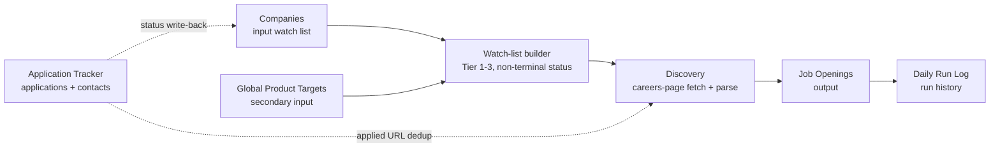

# Tracker Workbook Report — `Master_Job_Tracker_final.xlsx`

**File audited:** `job-agent/Master_Job_Tracker_final.xlsx`
**Report date:** 2026-11-06
**Method:** Read-only workbook inspection (sheet inventory, headers, used ranges, formulas, hyperlinks, validations, tables, charts, merged cells, defined names).
**Privacy:** Sanitized. No personal data, credentials, local paths, real company records, or contact records are included. Sample rows are anonymized.

---

## 1. Key finding: this is a starter workbook, not the full company master

The file you named is a **minimal 5-sheet starter workbook**. It contains:

- **2 sample company rows**
- **No job records**
- **No application/contact records**
- **An empty secondary-target sheet**
- **3 dry-run log rows**

A **separate, much richer workbook** exists one level above the project folder. That richer workbook is the actual research database:

- **19 sheets**
- **693 company rows** in `Companies`
- **69 columns** in `Companies`
- **50 rows** in `Global Product Targets`
- **201 rows** in `Application Tracker`
- A `Recruiter Contacts` sheet with **695 rows including the header**

**So there are two different “sources of truth” in practice:**

| Role | Workbook | What it contains |
|---|---|---|
| Company research master | Richer workbook in the parent directory | 693 companies, 69-column schema, contacts, research, provenance |
| Project-local starter | The file named in this report | 5 sheets, 2 sample companies, empty job/application sheets |

**Critical operational issue:** the current code’s tracker resolver checks the current project directory first. Therefore the running agent will use this **2-row starter**, not the 693-row master, unless the tracker path is made explicit. This is a code/configuration issue, not a workbook-content issue.

---

## 2. Sheet inventory of this file

| Sheet | Used range | Rows in file | Columns | Data rows | Role |
|---|---|---:|---:|---:|---|
| `Job Openings` | `A1:S1` | 1 | 19 | 0 | Output of discovery |
| `Daily Run Log` | `A1:K4` | 4 | 11 | 3 | Run history |
| `Companies` | `A1:G3` | 3 | 7 | 2 | Input watch list |
| `Application Tracker` | `A1:Z1` | 1 | 26 | 0 | Application/contact tracking |
| `Global Product Targets` | `A1` | 1 | 1 | 0 | Secondary target list (empty here) |

### Structural properties

| Property | Result |
|---|---|
| Formulas | 0 |
| Hyperlinks | 0 |
| Data validations | 0 |
| Excel tables | 0 |
| Charts | 0 |
| Merged cells | 0 |
| Defined names | 0 |
| External links | 0 |
| Column widths | Not set |
| Hidden sheets | None |
| Freeze panes | `A2` on the first four sheets |
| Auto-filter | Header row only on the first four sheets |
| Document author metadata | `openpyxl` |

**Why no validations:** the thin workbook was created as a bare template. The module that adds dropdown validations (`excel_io.ensure_new_sheets`) only adds them when it creates the sheets; because these sheets already exist, it does not add them.

---

## 3. Exact content summary

### 3.1 `Companies` — input watch list

Headers (7):

`Master ID` · `Company Name` · `Priority Tier (Best Available)` · `Application Status` · `Official Careers Page` · `Current Openings URL` · `Company Website`

Current rows (anonymized):

| Master ID | Company | Tier | Status | Careers URL | Openings URL | Website |
|---|---|---|---|---:|---:|---:|
| MID001 | Sample Company A (public placeholder) | Tier 1 | Open | Yes | Yes | Yes |
| MID002 | Sample Company B (public placeholder) | Tier 2 | Open | Yes | Yes | Yes |

These are **sample entries**, not the real target list. Both are `Open`, so a run against this file would select both companies.

### 3.2 `Job Openings` — discovery output

Headers (19):

`Job Key` · `Date Found` · `Master ID` · `Company` · `Job Title` · `Location` · `Work Mode` · `Experience Required` · `Posted Date` · `Job Link` · `Found Via` · `Match Score` · `Match Reasons` · `Decision` · `Skip Reason` · `Apply Status` · `Date Applied` · `Application Tracker #` · `Last Checked`

Current state: **header only — zero job rows.**

This sheet is written by the agent; it is not the company master.

### 3.3 `Daily Run Log` — run history

Headers (11):

`Run Date` · `Mode (dry/live)` · `Companies Checked` · `Sources Failed` · `New Jobs Found` · `Matched` · `Applied` · `Manual Needed` · `Skipped` · `Errors` · `Notes`

Current rows:

| Run Date | Mode | Companies Checked | New Jobs | Matched | Applied | Errors |
|---|---|---:|---:|---:|---:|---:|
| 2026-11-06 | dry | 0 | 0 | 0 | 0 | 0 |
| 2026-11-06 | dry | 2 | 2 | 2 | 0 | 0 |
| 2026-11-06 | dry | 2 | 0 | 0 | 0 | 0 |

**Important:** the middle row reports 2 discovered/matched jobs, but `Job Openings` is empty. The same-day backup contains 2 placeholder jobs with `example.com` links from an older/simulated code path. **Do not treat those log numbers as real-world success.**

### 3.4 `Application Tracker` — applications and contacts

Headers (26):

`#` · `Entry Source` · `Date Logged` · `Company` · `Master ID (auto)` · `Contact First Name` · `Contact Last Name` · `Contact Name (as given)` · `Contact Role / Title` · `LinkedIn URL` · `Email` · `Email Source` · `Job / Internship Title` · `Application URL` · `Hook (one specific line)` · `Outreach Status` · `Date Sent` · `Days Since Sent` · `Opened?` · `Replied?` · `Response Status` · `Follow-up Sent?` · `Follow-up Date` · `Interview Status` · `Outcome` · `Notes`

Current state: **header only — zero rows.**

This is the only sheet in this file designed to hold contact data. A populated version would contain personal data and must be sanitized before sharing.

### 3.5 `Global Product Targets` — secondary target list

Current state: **completely empty (`A1` only, no headers).**

In the richer parent workbook this sheet has 15 columns and 50 target rows. The current code reads the wrong columns from it, so it is not reliable in either workbook yet.

---

## 4. Data dictionary: the richer master’s `Companies` sheet

The parent workbook’s `Companies` sheet has **69 columns**. Grouped by purpose:

### Identity and classification (18)

`Master ID`, `Company Name`, `Name Variants`, `Primary State`, `Primary City`, `All Locations (merged)`, `Company Category`, `Approximate Company Size`, `Priority Tier (Best Available)`, `Tier Source`, `Fresher Accessibility Score`, `Score Range (L300 text)`, `Hiring Difficulty Estimate`, `Verification Flag`, `Evidence Status`, `Research Confidence`, `Last Verified Date`, `Verified Date Source`

### Hiring evidence and strategy (12)

`Fresher Hiring Evidence`, `Internship Availability Evidence`, `PPO Availability or Evidence`, `Suitable Entry-Level Job Titles`, `Minimum Experience Requirements`, `Relevant Technical Skills`, `Application Method`, `Interview Process Information`, `Recommended Application Strategy`, `Additional Notes`, `Priority Tier Rationale`, `Score Status`

### Links and search helpers (17)

`Website Basis`, `Company Website`, `Official Careers Page`, `Official LinkedIn Company Page`, `Current Openings URL`, `Fresher Hiring Source URL`, `Internship Source URL`, `PPO Source URL`, `Recruitment Process Source URL`, `LinkedIn People Search URL`, `LinkedIn Recruiter Search URL`, `LinkedIn Hiring Manager Search URL`, `LinkedIn Company Search (helper)`, `Careers Web Search (helper)`, `LinkedIn Talent Acquisition Search`, `LinkedIn HR Manager Search`, `LinkedIn Campus Recruiter Search`

> One public-search-helper column is named after a search engine in the original workbook. Its label is genericized here to keep this report free of unnecessary company names.

### Scoring components (6)

`Pts: Fresher Evidence (30)`, `Pts: Internship (20)`, `Pts: Geography (15)`, `Pts: 0-1 yr Suitability (15)`, `Pts: Application Access (10)`, `Pts: Recurring Hiring (10)`

### Regional and source tiers (6)

`Region Sheets (source)`, `Region Match (CSE)`, `Tier (CSE)`, `Tier (DB26)`, `Tier (L300)`, `Priority Tier (Source Label)`

### Status and workflow (4)

`Application Status`, `Date Applied`, `Next Action Date`, `My Notes`

### Provenance and data quality (6)

`Source Files`, `Source IDs`, `Records Merged`, `Missing Key Fields`, `Missing Count`, `Alternate Values (count)`

**Total: 69 columns.**

---

## 5. Parent workbook at a glance

| Sheet | Rows incl. header | Columns | Role |
|---|---:|---:|---|
| `README` | 49 | 2 | Documentation |
| `Dashboard` | 87 | 4 | Summary view |
| `Companies` | 694 | 69 | Company research master |
| `Application Tracker` | 201 | 26 | Applications and contacts |
| `Global Product Targets` | 51 | 15 | Secondary target list |
| `Internships and PPO` | 347 | 25 | Internship/PPO research |
| `Recruiter Contacts` | 695 | 18 | Contact research — sensitive |
| `Job Platforms` | 16 | 10 | Platform list |
| `Platform Strategy` | 40 | 3 | Strategy notes |
| `Email Templates` | 49 | 2 | Outreach templates |
| `Research Sources` | 358 | 9 | Source provenance |
| `Top 30 (CSE)` | 53 | 9 | Shortlist |
| `Possible Duplicates` | 16 | 13 | Data-quality review |
| `Merge Log` | 179 | 7 | Merge history |
| `Alternate Values` | 4153 | 6 | Alternate source values |
| `Source Notes Archive` | 159 | 7 | Archived notes |
| `Lists` | 15 | 10 | Dropdown values |
| `Verification` | 27 | 6 | Verification log |
| `Raw Source Rows` | 941 | 52 | Raw research data |

### Verified aggregate facts about the parent workbook

- **693 company rows** in `Companies`.
- Tier distribution: **215 Tier 1, 160 Tier 2, 71 Tier 3, 247 Tier 4**.
- All company application statuses are currently **`Not Started`**.
- **526** rows have an `Official Careers Page` URL.
- **545** rows have a `Current Openings URL`.
- Only **4** rows point at a recognizable ATS host; the rest are generic company sites.
- **50** global-target rows; their `Careers Page` cells display a label and store the real URL as an Excel hyperlink.
- The parent workbook does **not** currently contain `Job Openings` or `Daily Run Log`; a historical backup does.

---

## 6. How the agent uses each sheet

### Read map

| Sheet | Read by | What is read |
|---|---|---|
| `Companies` | `excel_io.get_companies_to_watch` | Master ID, Company Name, Tier, Application Status, careers/opening/website URLs |
| `Global Product Targets` | `main.py` | Currently wrong columns; should be Company, Careers Page, Status, Matched Master ID |
| `Job Openings` | `excel_io.get_job_openings_keys`, `get_applied_urls` | Job Key, Job Link, Apply Status |
| `Application Tracker` | `excel_io.get_applied_urls` | Application URL |
| `Daily Run Log` | Not read | Append-only history |

### Write map

| Sheet | Written by | What is written |
|---|---|---|
| `Job Openings` | `excel_io.append_job_opening` | New discovered-job rows |
| `Daily Run Log` | `excel_io.append_daily_log` | One row per run |
| `Companies` | `excel_io.update_companies_row` | Only Application Status, Date Applied, Next Action Date, My Notes |
| `Application Tracker` | `excel_io.append_to_application_tracker` | Application/contact fields when an application path runs |

### Watch-list rules in code

- Selects rows whose tier is exactly `Tier 1`, `Tier 2`, or `Tier 3`.
- Excludes statuses: `Applied`, `Interview`, `Offer`, `Rejected`, `Withdrawn`, `Closed`.
- Caps the run at `max_companies_per_run` (default 150).
- Uses `careers_page` for discovery; `Current Openings URL` and `Company Website` are read but not used.
- This file’s two sample rows are `Open`, so both would be selected.

---

## 7. Source-of-truth clarification for collaborators

### If you mean “the real company research database”

It is the **19-sheet, 693-company workbook in the parent directory**, not the 5-sheet file named in this report.

### If you mean “the file the current agent actually reads”

It is **this 5-sheet, 2-company starter**, because the code prefers a workbook in the current project directory.

### Consequence

The agent can appear to be “working” while operating on 2 sample companies, leaving the 693-company master untouched. Before any real run:

1. Decide which workbook is authoritative.
2. Make the path explicit in configuration or code.
3. Remove or rename the starter so it does not shadow the master.
4. Re-run in dry-run mode against a copy.
5. Confirm the watch-list count and tier distribution in the log.

---

## 8. What is safe to share

### Safe or low-risk

- This report.
- The **5-sheet starter workbook** itself: it contains only public sample rows and no personal/contact data. Review it once before sharing.
- The two existing audit reports in the same folder.
- A **header-only template** of the workbook.

### Do not share raw

- The **19-sheet parent master** — it contains company research and a populated `Recruiter Contacts` sheet.
- `profile.yaml` — applicant data.
- `answers.yaml` — pre-approved form answers.
- The resume PDF.
- `browser_profile/` — cookies/session data.
- `backups/` — historical workbooks, including placeholder job rows.
- `logs/` and `proofs/` — run artifacts.
- `.env` if present — credentials.
- Any workbook with populated `Application Tracker` or `Recruiter Contacts` rows.

### Sharing recommendation

Share **only** the `shareable-project-report/` folder, not the project root. If the recipient needs the company schema, give them this report or a header-only workbook. If they need the real company list, produce a **sanitized extract** that removes contacts, personal notes, and private URLs first.

---

## 9. Data-quality issues in this workbook

| Issue | Impact | Recommendation |
|---|---|---|
| Only 2 sample companies | Not representative of the real search | Populate from a controlled source or use the parent master |
| `Global Product Targets` empty | Secondary target feature cannot run | Add headers and rows, or disable the merge |
| `Job Openings` empty | No discovery history | Expected until discovery is fixed |
| `Application Tracker` empty | No application/contact history | Expected; populate through a real apply path |
| No data validations | Typos in tier/status can break selection | Add dropdowns for tier, status, decision |
| No formulas | No automatic Master ID, days-since-sent, or lookup | Add formulas deliberately and document them |
| No hyperlinks | URLs are plain text in this stub | Preserve real hyperlinks when importing |
| No column widths | Harder to review | Set widths for readability |
| Thin schema | Missing 62 of the master’s 69 company columns | Use the parent schema if research depth is needed |
| Same-day log rows include placeholder results | Misleading if shared as success | Keep the warning in this report; do not cite them as real |

---

## 10. Verification performed (read-only)

- Opened the workbook with `openpyxl` and the Excel inspection tools.
- Confirmed sheet names, used ranges, row/column counts, headers, freeze panes, auto-filters.
- Counted formulas, hyperlinks, validations, tables, charts, merged cells, defined names, external links.
- Read all populated cells in the 5-sheet starter.
- Compared against the richer parent workbook at the structural level only (sheet inventory, column counts, aggregate tier/status/URL counts).
- Did **not** read or copy parent-workbook company, contact, or personal records into this report.
- Did **not** modify the workbook or any project file.

**Not verified:** whether the parent workbook is the intended production master; the correctness of its 693 records; the contents of `Recruiter Contacts`; the validity of every URL; and whether the placeholder jobs in the historical backup were ever intended as fixtures.

---

*End of workbook report.*
